# Design Document: Gap Analysis and Verification

## Overview

This design addresses the comprehensive gap analysis between the original Zerna scRNA-seq platform (`scrna_platform`) and the new zerna-platform monorepo. The old platform is a Streamlit-based layered Python application; the new platform is a cloud-native monorepo with FastAPI (control plane), Next.js (frontend), Temporal (workflow orchestration), and Nextflow (compute plane).

The gap analysis covers 26 requirements spanning 9 known gaps (G-001 through G-009) plus 17 additional structural gaps discovered through code-level comparison. The design organizes remediation into six architectural domains:

1. **Data Ingestion & Binding** (Req 1, 3, 8) — upload parity, dataset versioning, run binding, stub replacement
2. **Compute Plane Parity** (Req 2, 17, 26) — real scientific backends, low-memory mode, GPU abstraction, repository pattern
3. **Annotation Domain** (Req 10–16, 18, 20–22) — deterministic gating, guardrails, label lifecycle, agentic annotation, CCI, myeloid audit, stromal resolution, Zerna index
4. **Analysis & Reporting** (Req 19, 23) — composition, DE utils, pathway, reporting, audit bundles, programs registry
5. **Analyst UX** (Req 4–7, 9, 25) — explorer, atlas, run history, export, interpreter, UI views
6. **Platform Extension** (Req 24) — plugin system, ML foundation

### Key Design Decisions

| Decision                                                                              | Rationale                                                                         |
| ------------------------------------------------------------------------------------- | --------------------------------------------------------------------------------- |
| New modules go into `methods/` (domain logic) and `apps/api/services/` (API services) | Follows existing monorepo separation of compute vs control plane                  |
| Annotation domain modules live under `methods/annotation/`                            | Keeps scientific logic co-located with existing annotation methods                |
| New UI views go into `apps/web/components/` and `apps/web/app/(dashboard)/`           | Follows existing Next.js app router pattern                                       |
| Pydantic v2 contracts in `packages/contracts/`                                        | Extends existing `ZernaBaseModel` pattern for schema consistency                  |
| Temporal workflows for long-running operations                                        | Consistent with existing `dataset_ingestion`, `run_execution`, `export` workflows |
| Hypothesis for property-based testing                                                 | Already present in both old and new projects (`.hypothesis/` dirs exist)          |

## Architecture

```mermaid
graph TB
    subgraph "Data Ingestion & Binding"
        Upload[Upload Service<br/>multipart + S3 URI]
        Merge[Merge Validator<br/>schema compat check]
        DSVer[Dataset Versioner<br/>immutable versions + lineage]
        RunBind[Run Binder<br/>dataset_version_id required]
    end

    subgraph "Annotation Domain"
        DGate[Deterministic Gating<br/>marker threshold rules]
        Guard[Guardrails<br/>ontology + hierarchy validation]
        LabelLC[Label Lifecycle<br/>draft → validate → finalize]
        AScore[Annotation Scoring<br/>confidence + marker evidence]
        Agentic[Agentic Annotation<br/>LLM-assisted refinement]
        CCI[CCI Labels<br/>ligand-receptor analysis]
        Myeloid[Myeloid Audit<br/>calibration + subtyping]
        Stromal[Stromal Resolution<br/>subtype disambiguation]
        Zerna[Zerna Label Index<br/>ontology harmonization]
        MarkerCache[Marker Cache<br/>precomputed scores]
        EvidScore[Evidence Scoring<br/>composite confidence]
    end

    subgraph "Analysis & Reporting"
        Comp[Composition Utils]
        DEUtil[DE Utilities]
        Pathway[Pathway Analysis]
        Report[Automated Reporting]
        AuditBundle[Audit Bundle Generator]
        Programs[Programs Registry<br/>cancer-type configs]
    end

    subgraph "Analyst UX (Next.js)"
        Explorer[Embedding Explorer]
        Atlas[Cell Type Atlas]
        Overview[Overview Dashboard]
        RunHist[Run History + Replay]
        Export[Export Center]
        Interp[Interpreter / Copilot]
        CellComm[Cell Communication View]
        CellChat[CellChat Analysis View]
        AnnotLog[Annotation Log View]
        EvidCard[Evidence Card Component]
        ObsInsp[Obs Schema Inspector]
    end

    subgraph "Platform Extension"
        Plugin[Plugin System<br/>custom analysis steps]
        MLFound[ML Foundation<br/>model versioning + provenance]
    end

    subgraph "Existing Infrastructure"
        API[FastAPI Control Plane]
        Temporal[Temporal Workflows]
        NF[Nextflow Compute]
        PG[(PostgreSQL)]
        S3[(S3 / MinIO)]
        Redis[(Redis)]
        GPU[GPU Abstraction]
    end

    Upload --> S3
    Upload --> DSVer
    DSVer --> PG
    RunBind --> PG
    Merge --> Upload

    DGate --> AScore
    Guard --> LabelLC
    AScore --> EvidScore
    Agentic --> LabelLC
    CCI --> Pathway

    Report --> S3
    AuditBundle --> S3
    Programs --> DGate

    Explorer --> API
    Atlas --> API
    RunHist --> API
    Export --> API
    Interp --> API

    Plugin --> API
    MLFound --> PG
```



## Components and Interfaces

### 1. Data Ingestion & Binding Components

#### UploadService (`apps/api/services/upload_service.py`)

- Accepts multipart file uploads for `h5ad`, `10x mtx`, `10x h5`, `csv`, `tsv`
- Accepts `s3://` URI registration (no browser upload required)
- Streams files to S3, creates dataset version with lineage metadata
- Interface: `upload_file(file, metadata) -> DatasetVersion`, `register_uri(uri, metadata) -> DatasetVersion`

#### MergeValidator (`apps/api/services/merge_validator.py`)

- Validates schema compatibility across multiple files before merge
- Reports field-level conflicts with actionable error messages
- Interface: `validate_merge(file_schemas: list[FileSchema]) -> MergeValidationResult`

#### DatasetVersionService (extends existing `dataset_service.py`)

- Creates immutable dataset versions with checksum, parent refs, timestamp, user, schema summary
- Interface: `create_version(dataset_id, file_ref, metadata) -> DatasetVersion`

#### RunBindingEnforcement (extends existing `run_service.py`)

- Requires `dataset_version_id` in run start contract
- Records dataset version checksum in run manifest
- Rejects run start without valid dataset version reference
- Interface: `start_run(template_id, dataset_version_id, params) -> Run`

### 2. Annotation Domain Components

#### DeterministicGatingModule (`methods/annotation/deterministic_gating.py`)

- Classifies cells using marker expression thresholds from configurable YAML/JSON panels
- Implements hierarchy mapping: general (L1/L2/L3), myeloid-specific, stromal-specific (v1/v2)
- Interface: `gate(adata, marker_panel, hierarchy_map) -> GatingResult`

#### AnnotationGuardrails (`methods/annotation/guardrails.py`)

- Validates labels against cell type ontologies and hierarchy constraints
- Normalizes variant label strings to canonical names
- Enforces annotation columns policy (required, optional, protected)
- Interface: `validate(labels, ontology, policy) -> GuardrailResult`

#### LabelLifecycleManager (`methods/annotation/label_lifecycle.py`)

- Manages draft → validate → finalize → post-finalize guard flow
- Defines label contract (required fields, types, constraints)
- Locks finalized labels; requires version increment for modification
- Interface: `validate_labels(labels) -> ValidationReport`, `finalize(labels, user) -> FinalizedLabels`

#### AnnotationScoringUtils (`methods/annotation/scoring.py`)

- Computes per-cluster and per-cell confidence scores from marker expression
- Loads versioned marker packs from Knowledge_Pack bundles
- Loads cell type taxonomies from ontology files
- Assigns subtypes using marker evidence
- Tests annotation robustness under perturbation
- Interface: `score(adata, markers) -> ScoreResult`, `load_markers(pack_id) -> MarkerPanel`

#### AnnotationEvaluation (`methods/annotation/evaluation.py`)

- Compares annotation across L1/L2/L3 layers, reports consistency metrics
- Validates marker packs against reference datasets (sensitivity/specificity)
- Tracks marker provenance (source, version, citation)
- Interface: `evaluate_layers(annotations) -> LayerConsistencyReport`

#### EvidenceScoring (`methods/annotation/evidence_scoring.py`)

- Computes composite confidence from marker expression, reference mapping, ontology alignment
- Builds searchable marker index across all loaded Knowledge_Packs
- Interface: `compute_evidence(assignment) -> EvidenceScore`, `search_markers(query) -> list[MarkerHit]`

#### AgenticAnnotation (`methods/annotation/agentic.py`)

- Accepts uncertain cluster labels, uses LLM to suggest refined annotations with reasoning
- Labels output as suggestion (requires human approval)
- Logs model version, prompt hash, reasoning chain
- Falls back to rule-based annotation if LLM unavailable
- Interface: `suggest(uncertain_labels, context) -> list[AgenticSuggestion]`

#### LowMemoryAnnotation (`methods/annotation/lowmem.py`)

- Processes annotation in chunked batches for resource-constrained environments
- Interface: `annotate_chunked(adata, chunk_size, method) -> AnnotationResult`

#### MarkerExpressionCache (`methods/annotation/marker_cache.py`)

- Caches precomputed marker scores keyed by dataset version
- Reuses cached scores for subsequent annotation runs on same dataset
- Interface: `get(dataset_version_id, markers) -> CachedScores | None`, `put(dataset_version_id, markers, scores)`

#### CCILabels (`methods/annotation/cci_labels.py`)

- Assigns interaction-relevant labels based on ligand/receptor expression
- Identifies significant ligand-receptor pairs between cell type pairs
- Postprocesses LR edges: filter, rank, annotate with pathway context
- Interface: `assign_cci_labels(adata) -> CCIResult`, `analyze_lr(adata) -> LRAnalysisResult`

#### MyeloidAudit (`methods/annotation/myeloid_audit.py`)

- Generates per-subtype confidence distributions and threshold recommendations
- Compares assigned subtypes against reference panels
- Produces structured report with precision, recall, confusion metrics
- Interface: `audit(annotations, reference_panel) -> MyeloidAuditReport`

#### StromalResolution (`methods/annotation/stromal_resolution.py`)

- Disambiguates broad "Stromal" labels into specific subtypes
- Produces per-cell subtype labels with confidence and marker evidence
- Interface: `resolve(adata, stromal_cells) -> StromalResolutionResult`

#### ZernaLabelIndex (`methods/annotation/zerna_index.py`)

- Maps labels across Cell Ontology (CL), common aliases, project-specific names
- Returns canonical label, ontology ID, aliases, hierarchy path
- Interface: `lookup(label) -> ZernaEntry`, `harmonize(labels) -> list[ZernaEntry]`

### 3. Analysis & Reporting Components

#### CompositionUtils (`methods/analysis/composition.py`)

- Cell type proportions, fold changes, statistical comparisons across conditions
- Interface: `compute_composition(adata, groupby, condition) -> CompositionResult`

#### DEUtils (`methods/analysis/de_utils.py`)

- Volcano plots, gene ranking, covariate-aware analysis helpers
- Interface: `volcano_data(de_results) -> VolcanoData`, `rank_genes(de_results) -> RankedGenes`

#### PathwayAnalysis (`methods/analysis/pathway.py`)

- Pathway activity scores using decoupler or equivalent
- Interface: `score_pathways(adata, pathway_db) -> PathwayScores`

#### AutomatedReporting (`methods/analysis/reporting.py`)

- QC reports, annotation summaries, run diagnostics
- Annotation debug export (diagnostic bundle)
- Audit bundle generator (QA metrics, calibration, provenance)
- Interface: `generate_qc_report(adata) -> Report`, `generate_audit_bundle(run) -> AuditBundle`

#### ProgramsRegistry (`methods/programs/registry.py`)

- Catalogs cancer-type-specific configs (marker panels, hierarchy mappings, defaults)
- Includes general and prostate-specific configurations
- Interface: `get_program(cancer_type) -> ProgramConfig`, `list_programs() -> list[ProgramConfig]`

### 4. Analyst UX Components (Next.js)

| Component          | Path                                                  | Description                                        |
| ------------------ | ----------------------------------------------------- | -------------------------------------------------- |
| EmbeddingExplorer  | `apps/web/components/embedding/EmbeddingExplorer.tsx` | Filter, gene overlay, color-by, split-view         |
| CellTypeAtlas      | `apps/web/components/analysis/CellTypeAtlas.tsx`      | Marker tables, confidence scores, expression plots |
| OverviewDashboard  | `apps/web/app/(dashboard)/overview/page.tsx`          | Dataset stats, run status, quality metrics         |
| RunHistory         | `apps/web/components/runs/RunHistory.tsx`             | Searchable list, load, replay                      |
| ExportCenter       | `apps/web/components/analysis/ExportCenter.tsx`       | h5ad/csv/Seurat, reproducibility report, PNG/SVG   |
| InterpreterPage    | `apps/web/app/(dashboard)/interpreter/page.tsx`       | NL query, result display, session history          |
| CellCommunication  | `apps/web/components/analysis/CellCommunication.tsx`  | LR interaction visualization                       |
| CellChatAnalysis   | `apps/web/components/analysis/CellChatAnalysis.tsx`   | CellChat networks, pathway enrichments             |
| AnnotationLog      | `apps/web/components/annotation/AnnotationLog.tsx`    | Chronological history with diffs                   |
| EvidenceCard       | `apps/web/components/annotation/EvidenceCard.tsx`     | Per-cluster evidence display                       |
| ObsSchemaInspector | `apps/web/components/datasets/ObsSchemaInspector.tsx` | `.obs` DataFrame schema display/validation         |

### 5. Platform Extension Components

#### PluginSystem (`apps/api/services/plugin_service.py`)

- Registers custom analysis steps without modifying core code
- Validates plugin input/output contracts against platform schema
- Interface: `register(plugin_def) -> PluginRegistration`, `list_plugins() -> list[PluginInfo]`

#### MLFoundation (`apps/api/services/ml_foundation_service.py`)

- Manages model versioning, inference provenance, metadata storage
- Records model version, input hash, inference timestamp for every inference
- Interface: `register_model(metadata) -> ModelRecord`, `log_inference(model_id, input_hash) -> InferenceLog`

### 6. Data Layer Components

#### ZernaConnector (`methods/data/zerna_connector.py`)

- Queries external Zerna knowledge base for markers, cell type definitions, pathway annotations
- Interface: `query_markers(cell_type) -> list[Marker]`, `query_pathways(gene_set) -> list[Pathway]`

#### GPUBackendAbstraction (extends existing `services/gpu_abstraction/`)

- Unified interface for CPU/GPU execution
- Falls back to CPU when GPU unavailable without code changes
- Already partially implemented; needs completion of fallback paths

#### RepositoryPattern (`methods/data/repository.py`)

- Abstracts storage operations (read, write, list, delete) behind consistent interface
- Interface: `read(key) -> bytes`, `write(key, data)`, `list(prefix) -> list[str]`, `delete(key)`

## Data Models

### Dataset & Versioning Models

```python
class DatasetVersion(OrganizationScopedModel):
    id: UUID
    dataset_id: UUID
    version_number: int
    checksum: str  # SHA-256 of source file(s)
    file_refs: list[str]  # S3 keys
    source_type: Literal["upload", "s3_uri", "merge"]
    parent_version_ids: list[UUID]  # for merge lineage
    schema_summary: dict[str, Any]  # column names, dtypes, shape
    uploaded_by: UUID
    created_at: datetime

class MergeValidationResult(ZernaBaseModel):
    compatible: bool
    conflicts: list[SchemaConflict]
    merged_schema: dict[str, Any] | None

class SchemaConflict(ZernaBaseModel):
    field: str
    file_a: str
    file_b: str
    type_a: str
    type_b: str
    message: str
```

### Run Manifest Models

```python
class RunManifest(ZernaBaseModel):
    run_id: UUID
    dataset_version_id: UUID
    dataset_checksum: str
    template_id: UUID
    parameters: dict[str, Any]
    method_versions: dict[str, str]  # step_name -> version
    random_seed: int | None
    created_at: datetime

class RunCheckpoint(ZernaBaseModel):
    run_id: UUID
    step_name: str
    status: RunStatus
    artifact_refs: list[str]
    started_at: datetime
    completed_at: datetime | None
    error_message: str | None
```

### Annotation Domain Models

```python
class GatingResult(ZernaBaseModel):
    cell_labels: dict[str, str]  # cell_id -> label
    gating_rule_ids: dict[str, str]  # cell_id -> rule_id
    marker_panel_version: str
    hierarchy_level: Literal["L1", "L2", "L3"]

class LabelContract(ZernaBaseModel):
    required_fields: list[str]
    field_types: dict[str, str]
    allowed_labels: list[str] | None
    hierarchy_constraints: dict[str, list[str]]  # parent -> allowed children

class GuardrailResult(ZernaBaseModel):
    valid: bool
    violations: list[GuardrailViolation]

class GuardrailViolation(ZernaBaseModel):
    cell_id: str
    label: str
    rule: str
    message: str

class FinalizedLabels(ZernaBaseModel):
    labels: dict[str, str]
    version: int
    finalized_by: UUID
    finalized_at: datetime
    locked: bool = True

class AgenticSuggestion(ZernaBaseModel):
    cluster_id: str
    original_label: str
    suggested_label: str
    confidence: float
    reasoning: str
    model_version: str
    prompt_context_hash: str
    is_authoritative: bool = False  # always False until human approval

class EvidenceScore(ZernaBaseModel):
    cell_type: str
    marker_score: float
    reference_mapping_score: float
    ontology_alignment_score: float
    composite_score: float

class MarkerHit(ZernaBaseModel):
    gene: str
    cell_types: list[str]
    source: str
    version: str
    confidence_weight: float

class CCIResult(ZernaBaseModel):
    cci_labels: dict[str, str]  # cell_id -> cci_label
    lr_pairs: list[LRPair]

class LRPair(ZernaBaseModel):
    ligand: str
    receptor: str
    source_cell_type: str
    target_cell_type: str
    interaction_score: float
    p_value: float
    pathway_annotations: list[str]

class MyeloidAuditReport(ZernaBaseModel):
    subtype_metrics: dict[str, SubtypeMetrics]
    confidence_distributions: dict[str, list[float]]
    threshold_recommendations: dict[str, float]

class SubtypeMetrics(ZernaBaseModel):
    precision: float
    recall: float
    f1: float
    confusion_counts: dict[str, int]

class StromalResolutionResult(ZernaBaseModel):
    subtype_labels: dict[str, str]  # cell_id -> subtype
    confidence_scores: dict[str, float]
    marker_evidence: dict[str, dict[str, float]]  # cell_id -> {marker: score}

class ZernaEntry(ZernaBaseModel):
    canonical_label: str
    ontology_id: str  # CL:XXXXXXX
    aliases: list[str]
    hierarchy_path: list[str]  # root -> leaf
```

### Analysis & Reporting Models

```python
class CompositionResult(ZernaBaseModel):
    proportions: dict[str, float]  # cell_type -> proportion
    fold_changes: dict[str, float] | None
    p_values: dict[str, float] | None

class ProgramConfig(ZernaBaseModel):
    cancer_type: str
    marker_panels: dict[str, str]  # panel_name -> file_ref
    hierarchy_mappings: dict[str, str]
    default_parameters: dict[str, Any]

class AuditBundle(ZernaBaseModel):
    run_id: UUID
    qa_metrics: dict[str, Any]
    calibration_data: dict[str, Any]
    provenance: dict[str, Any]
    generated_at: datetime
```

### Platform Extension Models

```python
class PluginRegistration(ZernaBaseModel):
    plugin_id: UUID
    name: str
    version: str
    input_contract: dict[str, Any]  # JSON Schema
    output_contract: dict[str, Any]
    registered_at: datetime

class ModelRecord(ZernaBaseModel):
    model_id: UUID
    name: str
    version: str
    metadata: dict[str, Any]
    registered_at: datetime

class InferenceLog(ZernaBaseModel):
    inference_id: UUID
    model_id: UUID
    model_version: str
    input_hash: str
    timestamp: datetime
```

## Correctness Properties

_A property is a characteristic or behavior that should hold true across all valid executions of a system — essentially, a formal statement about what the system should do. Properties serve as the bridge between human-readable specifications and machine-verifiable correctness guarantees._

### Property 1: File upload accepts all supported formats

_For any_ file with extension in {h5ad, mtx, h5, csv, tsv}, the upload service should accept the file and persist it to object storage, returning a valid file reference. _For any_ file with an unsupported extension, the upload service should reject it with a validation error.

**Validates: Requirements 1.1**

### Property 2: Merge validation detects schema conflicts

_For any_ pair of dataset schemas, if they have incompatible column types or missing required columns, the merge validator should report `compatible=False` with a non-empty list of `SchemaConflict` entries that reference the specific conflicting fields. If schemas are compatible, it should report `compatible=True` with an empty conflict list.

**Validates: Requirements 1.4, 1.6**

### Property 3: Dataset version immutability and lineage completeness

_For any_ imported dataset, the resulting `DatasetVersion` must have a non-null `checksum`, `uploaded_by`, `created_at`, `schema_summary`, and `source_type`. For merge-sourced versions, `parent_version_ids` must be non-empty.

**Validates: Requirements 1.5**

### Property 4: Step output schema conformance

_For any_ pipeline step output, validating it against the corresponding contract schema in `packages/contracts` must succeed without errors.

**Validates: Requirements 2.2**

### Property 5: Checkpoint persistence on step failure

_For any_ pipeline step that fails during execution, a `RunCheckpoint` with `status=FAILED` and a non-null `error_message` must be persisted, and the run must be resumable from that checkpoint.

**Validates: Requirements 2.6**

### Property 6: Run start requires dataset version binding

_For any_ run start request, if `dataset_version_id` is missing or references a non-existent version, the request must be rejected. For valid requests, the resulting `RunManifest` must contain the `dataset_version_id` and `dataset_checksum`.

**Validates: Requirements 3.1, 3.2, 3.3**

### Property 7: Deterministic method replay reproducibility

_For any_ deterministic method and a given `RunManifest` (same dataset version, parameters, and random seed), replaying the method must produce byte-identical outputs.

**Validates: Requirements 3.4**

### Property 8: Run persistence round-trip

_For any_ run created with sessions, checkpoints, and events, querying the database must return the same run data with all associated records intact.

**Validates: Requirements 5.1**

### Property 9: Export format support and reproducibility report completeness

_For any_ export request with format in {h5ad, csv, seurat}, the export service must produce a valid artifact. Every export must include a reproducibility report containing `run_manifest`, `parameter_provenance`, and `method_versions` fields.

**Validates: Requirements 6.2, 6.3**

### Property 10: Query session history persistence

_For any_ processed interpreter query, the query text and result must appear in the user's session history when retrieved.

**Validates: Requirements 7.3**

### Property 11: Persistent storage CRUD round-trip

_For any_ project or DAG definition created via the API, reading it back must return the same data. For DAG definitions, version history must be preserved across updates.

**Validates: Requirements 8.1, 8.2**

### Property 12: Annotation workflow auto-wiring from completed runs

_For any_ pipeline run that has completed clustering, the annotation workflow must be able to retrieve cluster results without manual JSON input.

**Validates: Requirements 9.1**

### Property 13: Deterministic gating classification correctness

_For any_ cell with marker expression values and a marker panel definition, the deterministic gating module must classify the cell according to the threshold rules in the panel. If a marker exceeds its threshold, the corresponding gating rule must fire.

**Validates: Requirements 10.1**

### Property 14: Hierarchy mapping consistency

_For any_ gating result and hierarchy mapping definition (general, myeloid, or stromal), the mapped labels must be valid entries in the hierarchy at the specified level (L1/L2/L3), and child labels must be consistent with their parent labels.

**Validates: Requirements 10.2, 10.3, 10.4**

### Property 15: Gating provenance completeness

_For any_ cell label produced by deterministic gating, the result must include the `gating_rule_id` and `marker_panel_version` used for that classification.

**Validates: Requirements 10.5**

### Property 16: Guardrail violation detection

_For any_ set of annotation labels and an ontology definition, the guardrails must flag every label that violates the ontology or hierarchy constraints. Labels that conform must pass validation.

**Validates: Requirements 11.1**

### Property 17: Label normalization idempotence

_For any_ label string, `normalize(normalize(label))` must equal `normalize(label)`. The normalized form must be a canonical cell type name.

**Validates: Requirements 11.2**

### Property 18: Annotation columns policy enforcement

_For any_ annotation operation, required columns must be present in the output, and protected columns must not be modified from their pre-annotation values.

**Validates: Requirements 11.3**

### Property 19: Guardrail-blocked finalization

_For any_ set of labels with at least one guardrail violation, the finalization step must reject the labels and return the violation details.

**Validates: Requirements 11.4**

### Property 20: Label contract validation completeness

_For any_ set of labels, validation against the label contract must report all violations (missing fields, wrong types, disallowed labels) — not just the first one found.

**Validates: Requirements 12.1, 12.2, 12.5**

### Property 21: Finalization locks labels

_For any_ finalized label set, the result must have `locked=True`, a non-null `finalized_at` timestamp, and a non-null `finalized_by` user ID.

**Validates: Requirements 12.3**

### Property 22: Post-finalize modification guard

_For any_ finalized label set, attempting to modify labels without incrementing the version number must fail. Modification with a version increment must succeed.

**Validates: Requirements 12.4**

### Property 23: Annotation confidence score bounds

_For any_ set of marker expressions, the annotation scoring utilities must produce confidence scores in the range [0.0, 1.0] for both per-cluster and per-cell scores.

**Validates: Requirements 13.1**

### Property 24: Marker pack and taxonomy loader round-trip

_For any_ valid Knowledge_Pack bundle, loading markers and then serializing them back must produce an equivalent marker panel. Similarly, loading a taxonomy and serializing it must preserve the hierarchy structure.

**Validates: Requirements 13.2, 13.3**

### Property 25: Subtype refinement hierarchy consistency

_For any_ broad cell type label refined to a subtype, the subtype must be a valid child of the broad label in the cell type hierarchy.

**Validates: Requirements 13.4**

### Property 26: Annotation robustness under perturbation

_For any_ annotation result, applying small perturbations (e.g., 5% cell subsampling) and re-annotating must produce labels that agree with the original on at least 90% of the shared cells.

**Validates: Requirements 13.5**

### Property 27: Annotation layer consistency

_For any_ set of annotations with L1, L2, and L3 layers, every L3 label must be a valid child of its L2 label, and every L2 label must be a valid child of its L1 label in the hierarchy.

**Validates: Requirements 14.1**

### Property 28: Marker provenance tracking completeness

_For any_ marker gene used in annotation, the provenance record must include `source`, `version`, and `citation` fields.

**Validates: Requirements 14.3**

### Property 29: Evidence scoring composite bounds and components

_For any_ cell type assignment, the composite evidence score must be in [0.0, 1.0] and must be a function of `marker_score`, `reference_mapping_score`, and `ontology_alignment_score`, all of which must also be in [0.0, 1.0].

**Validates: Requirements 15.1**

### Property 30: Marker index completeness and search

_For any_ set of loaded Knowledge_Packs, the marker index must contain every marker from every pack. For any query matching a known marker, the search result must include `cell_types`, `source`, and `confidence_weight`.

**Validates: Requirements 15.2, 15.3**

### Property 31: Agentic suggestion metadata invariants

_For any_ agentic annotation suggestion, `is_authoritative` must be `False`, and the suggestion must include non-null `model_version`, `prompt_context_hash`, and `reasoning` fields.

**Validates: Requirements 16.2, 16.3**

### Property 32: LLM fallback to rule-based annotation

_For any_ annotation request where the LLM service is unavailable, the system must produce valid annotations using rule-based methods without raising an error.

**Validates: Requirements 16.4**

### Property 33: Low-memory mode equivalence

_For any_ dataset, processing annotation in chunked low-memory mode must produce results equivalent to processing the full dataset at once.

**Validates: Requirements 17.1**

### Property 34: Marker cache round-trip

_For any_ marker scores computed for a dataset version, storing them in the cache and retrieving them must return identical scores.

**Validates: Requirements 17.2, 17.3**

### Property 35: CCI label assignment from expression

_For any_ cell with ligand or receptor expression above the detection threshold, the CCI module must assign an interaction-relevant label.

**Validates: Requirements 18.1**

### Property 36: LR analysis output completeness and ranking

_For any_ ligand-receptor analysis result, every LR pair must include `interaction_score`, `p_value`, and `pathway_annotations`. The pairs must be sorted by interaction score in descending order after postprocessing.

**Validates: Requirements 18.2, 18.3, 18.4**

### Property 37: Composition proportions sum to one

_For any_ set of cell type counts, the computed proportions must sum to 1.0 (within floating-point tolerance).

**Validates: Requirements 19.1**

### Property 38: DE utility volcano data completeness

_For any_ differential expression result set, the volcano plot data must contain `log2_fold_change` and `neg_log10_pvalue` for every gene in the input.

**Validates: Requirements 19.2**

### Property 39: Report and audit bundle completeness

_For any_ completed run, the QC report must contain all required sections. The annotation debug export must contain diagnostic data. The audit bundle must contain `qa_metrics`, `calibration_data`, and `provenance`.

**Validates: Requirements 19.4, 19.5, 19.6**

### Property 40: Myeloid calibration output structure

_For any_ myeloid annotation result, the calibration output must contain per-subtype confidence distributions and threshold recommendations for every identified subtype.

**Validates: Requirements 20.1**

### Property 41: Myeloid audit report structure

_For any_ completed myeloid audit, the report must contain `precision`, `recall`, and `confusion_counts` for every subtype.

**Validates: Requirements 20.3**

### Property 42: Stromal resolution produces specific subtypes with evidence

_For any_ cell labeled "Stromal" with sufficient marker evidence, the resolution module must produce a specific subtype label, a confidence score in [0, 1], and non-empty marker evidence.

**Validates: Requirements 21.1, 21.2**

### Property 43: Zerna label index lookup completeness

_For any_ label in the Zerna index, lookup must return `canonical_label`, `ontology_id`, `aliases`, and `hierarchy_path`. Looking up the canonical label must return the same entry (idempotent lookup).

**Validates: Requirements 22.1, 22.2**

### Property 44: Programs registry round-trip

_For any_ registered program configuration, retrieving it by cancer type must return the same marker panels, hierarchy mappings, and default parameters.

**Validates: Requirements 23.1**

### Property 45: Program selection applies correct defaults

_For any_ selected cancer program, the pipeline configuration must use that program's marker panels and default parameters.

**Validates: Requirements 23.4**

### Property 46: Plugin registration and contract validation

_For any_ plugin with valid input/output contracts, registration must succeed and the plugin must be retrievable. _For any_ plugin with contracts that violate the platform schema, registration must fail with validation errors.

**Validates: Requirements 24.1, 24.3**

### Property 47: ML inference provenance logging

_For any_ ML model inference, the log must contain `model_version`, `input_hash`, and `timestamp`. _For any_ registered model, retrieval must return the same version and metadata.

**Validates: Requirements 24.2, 24.4**

### Property 48: Obs schema validation

_For any_ `.obs` DataFrame schema, the inspector must correctly identify missing required columns and type mismatches against the expected schema.

**Validates: Requirements 25.6**

### Property 49: GPU/CPU execution equivalence and fallback

_For any_ compute step, the result produced on CPU must be numerically equivalent (within tolerance) to the result on GPU. When GPU is unavailable, the system must fall back to CPU and produce valid results without error.

**Validates: Requirements 26.2, 26.4**

### Property 50: Repository pattern round-trip

_For any_ data written via the repository interface, reading it back with the same key must return identical bytes.

**Validates: Requirements 26.3**

## Error Handling

### Error Categories

| Category            | HTTP Code | Retry              | Example                                                                                  |
| ------------------- | --------- | ------------------ | ---------------------------------------------------------------------------------------- |
| Validation Error    | 422       | No                 | Missing `dataset_version_id`, invalid file format, schema conflict                       |
| Not Found           | 404       | No                 | Non-existent dataset version, unknown program, missing marker pack                       |
| Conflict            | 409       | No                 | Modifying finalized labels without version increment, duplicate plugin name              |
| Service Unavailable | 503       | Yes                | LLM service down (triggers rule-based fallback), GPU unavailable (triggers CPU fallback) |
| Internal Error      | 500       | Yes (with backoff) | Pipeline step failure (checkpoint persisted), storage write failure                      |

### Error Handling Strategies

1. **Merge Validation Failures**: Return `MergeValidationResult` with `compatible=False` and detailed `SchemaConflict` list. Never proceed with merge on validation failure.

2. **Pipeline Step Failures**: Persist `RunCheckpoint` with error details. Allow resume from failed step. Emit failure event to Temporal for workflow-level retry decisions.

3. **Guardrail Violations**: Return `GuardrailResult` with all violations. Block finalization until all violations are resolved. Never silently skip violations.

4. **Label Contract Violations**: Return complete violation report (all violations, not just first). Include field name, expected type/value, and actual value for each violation.

5. **LLM Service Unavailability**: Fall back to rule-based annotation. Log the fallback event. Do not block the pipeline. Return results with a metadata flag indicating fallback was used.

6. **GPU Unavailability**: Fall back to CPU execution transparently. Log the fallback. Results must be numerically equivalent within tolerance.

7. **Cache Misses**: Recompute marker scores on cache miss. Populate cache after computation. Never fail due to cache unavailability.

8. **Export Failures**: Return actionable error with the specific format that failed. Allow retry of individual format exports.

### Error Response Format

All errors follow the existing `ErrorResponse` contract from `packages/contracts`:

```python
ErrorResponse(
    error_type="user_error" | "system_error" | "transient_error",
    error_code="MERGE_VALIDATION_FAILED" | "LABEL_CONTRACT_VIOLATION" | ...,
    message="Human-readable description",
    details={"conflicts": [...], "violations": [...]},
    request_id="trace-id",
    timestamp=datetime.utcnow()
)
```

## Testing Strategy

### Dual Testing Approach

This feature requires both unit tests and property-based tests:

- **Unit tests**: Verify specific examples, edge cases, integration points, and error conditions
- **Property tests**: Verify universal properties across randomly generated inputs using Hypothesis

Both are complementary: unit tests catch concrete bugs at known boundaries, property tests verify general correctness across the input space.

### Property-Based Testing Configuration

- **Library**: [Hypothesis](https://hypothesis.readthedocs.io/) (already present in both projects — `.hypothesis/` directories exist)
- **Minimum iterations**: 100 per property test (via `@settings(max_examples=100)`)
- **Tag format**: Each test tagged with a comment: `# Feature: gap-analysis-and-verification, Property {N}: {title}`
- **Each correctness property maps to exactly one property-based test**

### Test Organization

```
tests/
├── properties/                          # Property-based tests
│   ├── test_upload_properties.py        # Properties 1-3
│   ├── test_pipeline_properties.py      # Properties 4-7
│   ├── test_run_properties.py           # Properties 8, 11
│   ├── test_export_properties.py        # Property 9
│   ├── test_interpreter_properties.py   # Property 10
│   ├── test_annotation_gating_properties.py    # Properties 13-15
│   ├── test_annotation_guardrails_properties.py # Properties 16-22
│   ├── test_annotation_scoring_properties.py    # Properties 23-26, 29-30
│   ├── test_annotation_eval_properties.py       # Properties 27-28
│   ├── test_agentic_properties.py       # Properties 31-32
│   ├── test_lowmem_cache_properties.py  # Properties 33-34
│   ├── test_cci_properties.py           # Properties 35-36
│   ├── test_analysis_properties.py      # Properties 37-39
│   ├── test_myeloid_properties.py       # Properties 40-41
│   ├── test_stromal_properties.py       # Property 42
│   ├── test_zerna_properties.py         # Property 43
│   ├── test_programs_properties.py      # Properties 44-45
│   ├── test_plugin_ml_properties.py     # Properties 46-47
│   ├── test_ui_validation_properties.py # Property 48
│   ├── test_compute_properties.py       # Property 49
│   └── test_repository_properties.py    # Property 50
├── unit/                                # Unit tests for examples and edge cases
│   ├── test_upload_unit.py
│   ├── test_merge_validator_unit.py
│   ├── test_gating_unit.py
│   ├── test_guardrails_unit.py
│   ├── test_label_lifecycle_unit.py
│   ├── test_export_unit.py
│   └── ...
└── integration/                         # Integration tests
    ├── test_pipeline_e2e.py
    ├── test_annotation_workflow_e2e.py
    └── test_run_replay_e2e.py
```

### Unit Test Focus Areas

- Specific file format acceptance/rejection examples (h5ad, csv, etc.)
- Merge conflict edge cases (empty schemas, single-column overlap)
- Gating threshold boundary cases (exactly at threshold)
- Label normalization edge cases (empty string, unicode, case variations)
- Export format-specific edge cases (empty dataset, large dataset)
- Interpreter query parsing edge cases (empty query, SQL injection attempts)
- Myeloid/stromal specific marker panel edge cases

### Property Test Hypothesis Strategies

Key custom strategies needed:

```python
# Example strategy definitions
from hypothesis import strategies as st

# Random cell type labels
cell_labels = st.text(min_size=1, max_size=50, alphabet=st.characters(whitelist_categories=("L",)))

# Random marker expression values
marker_expressions = st.dictionaries(
    keys=st.text(min_size=1, max_size=20),
    values=st.floats(min_value=0.0, max_value=100.0, allow_nan=False),
    min_size=1, max_size=50
)

# Random schema definitions
schema_defs = st.dictionaries(
    keys=st.text(min_size=1, max_size=30),
    values=st.sampled_from(["float64", "int64", "object", "bool", "category"]),
    min_size=1, max_size=20
)

# Random hierarchy definitions
hierarchy_levels = st.fixed_dictionaries({
    "L1": st.text(min_size=1, max_size=30),
    "L2": st.text(min_size=1, max_size=30),
    "L3": st.text(min_size=1, max_size=30),
})
```
