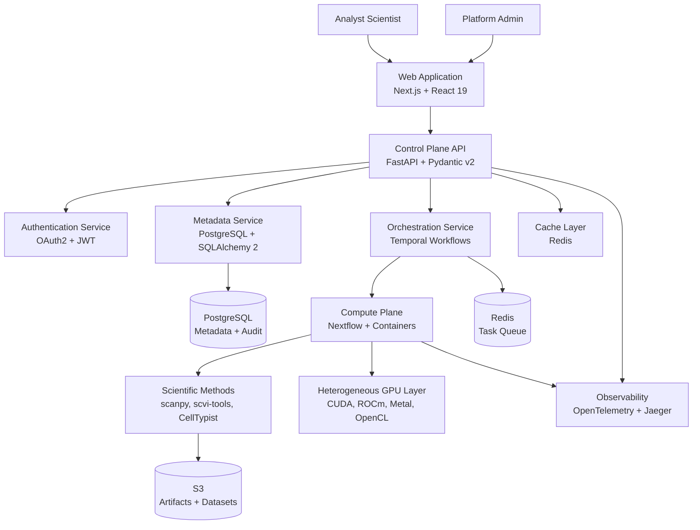
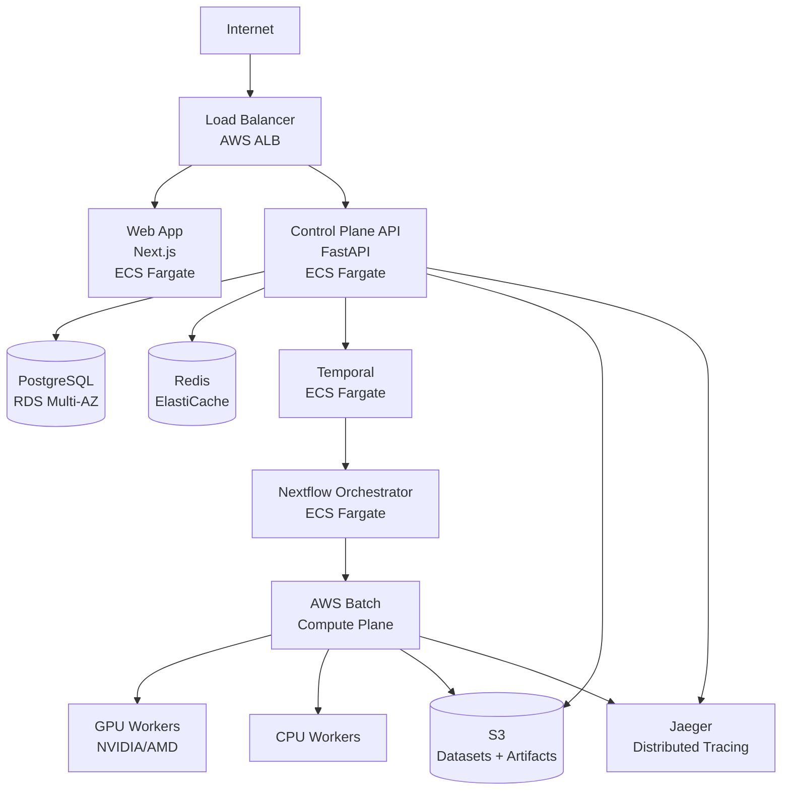

# Design Document: Zerna Platform Rebuild

## Overview

Zerna is a production-ready, cloud-native single-cell analysis platform designed for multi-user cancer research environments. This design rebuilds the platform from scratch with a clean separation between control plane (metadata, orchestration, API) and compute plane (scientific method execution), eliminating the monolithic UI-driven architecture of the POC.

### Core Design Principles

1. **Separation of Concerns**: Control plane handles product workflows via Temporal; compute plane executes scientific DAGs via Nextflow
2. **Multi-Tenancy First**: Organization-scoped data isolation at database, storage, and compute layers
3. **Observability by Default**: OpenTelemetry instrumentation across all services
4. **Contract-Driven Development**: Pydantic v2 schemas generate TypeScript SDK and OpenAPI specs
5. **Reproducibility**: Immutable pipeline versions, provenance tracking, and deterministic execution
6. **Heterogeneous Compute**: Support for NVIDIA/AMD/Apple/Intel/TPU hardware via abstraction layer
7. **Post-Pipeline Analysis**: Cross-dataset pathway analysis and LLM integration independent of initial runs

### High-Level Architecture

The platform consists of three primary subsystems:

**Control Plane** (FastAPI + PostgreSQL + Redis + Temporal)

- Authentication and authorization (OAuth2 + JWT)
- Project, dataset, and run metadata management
- API gateway for frontend and external integrations
- Product workflow orchestration (ingestion, export, cross-dataset analysis)
- Multi-tenancy enforcement and resource quotas

**Compute Plane** (Nextflow + Containerized Methods)

- Scientific pipeline execution (QC, normalization, clustering, annotation)
- Heterogeneous GPU orchestration (CUDA, ROCm, Metal, OpenCL)
- Method isolation with explicit input/output contracts
- Artifact generation and storage (h5ad, plots, reports)

**Frontend** (Next.js + React 19 + WebGL)

- Server-side rendering for initial page loads
- Interactive embedding visualization with tile-based rendering
- Real-time run status updates via WebSocket
- Export and reproducibility report generation

## Architecture

### System Context Diagram



### Control Plane Architecture

The control plane is a FastAPI application with the following layers:

**API Layer** (`apps/api`)

- RESTful endpoints with Pydantic v2 request/response validation
- OpenAPI spec generation for SDK clients
- JWT-based authentication middleware
- Organization-scoped query filters
- Rate limiting (token bucket per user)
- CORS configuration for web app

**Service Layer** (`apps/api/services`)

- `AuthService`: User authentication, token generation, permission checks
- `DatasetService`: Dataset CRUD, version management, file validation
- `RunService`: Run lifecycle, status tracking, artifact retrieval
- `PipelineService`: Template management, parameter validation
- `AnnotationService`: Cell type annotation CRUD, revision tracking
- `KnowledgePackService`: Reference data versioning
- `AuditService`: Immutable event logging
- `PathwayService`: Cross-dataset pathway analysis orchestration, LLM integration

**Data Layer** (`apps/api/models`)

- SQLAlchemy 2 ORM models with organization_id foreign keys
- Alembic migrations for schema evolution
- Composite indexes for multi-tenant queries
- JSONB columns for flexible metadata

**Workflow Layer** (`workflows`)

- Temporal workflows for product operations:
  - `DatasetIngestionWorkflow`: File upload → validation → metadata extraction
  - `RunExecutionWorkflow`: Template resolution → Nextflow invocation → artifact collection
  - `ExportWorkflow`: h5ad generation → report compilation → S3 upload
  - `CrossDatasetPathwayWorkflow`: Multi-dataset aggregation → LLM interpretation → insight generation

### Compute Plane Architecture

The compute plane executes scientific methods in isolated containers orchestrated by Nextflow:

**Orchestration Layer** (`services/compute/orchestrator`)

- Nextflow DSL2 pipelines with explicit channel definitions
- Dynamic resource allocation based on dataset size
- Heterogeneous compute scheduling via custom executor
- Checkpoint/resume support for long-running pipelines
- Artifact staging to S3 with versioned paths

**Method Definitions** (`methods/`)

- Isolated Python modules with no cross-method imports
- Pydantic schemas for input/output validation
- Containerized execution (Docker images per method)
- GPU-aware implementations with fallback to CPU
- Deterministic execution with fixed random seeds

**Heterogeneous Compute Layer** (`services/compute/gpu_abstraction`)

- Runtime hardware detection (CUDA, ROCm, Metal, OpenCL, TPU)
- Unified tensor operation interface
- Automatic backend selection based on availability
- Method-level compute preferences (CPU-only, GPU-preferred, GPU-required)
- Workload distribution across heterogeneous hardware

**Method Categories**:

- **Preprocessing**: QC filtering, doublet detection, normalization
- **Dimensionality Reduction**: HVG selection, PCA, batch correction
- **Clustering**: Leiden, Louvain with resolution sweeps
- **Embedding**: UMAP, t-SNE with reproducible seeds
- **Annotation**: CellTypist integration, confidence scoring
- **Differential Expression**: Wilcoxon, t-test, DESeq2-like methods
- **Pathway Analysis**: decoupler scoring, cross-dataset aggregation
- **Cell Communication**: LIANA ligand-receptor analysis

### Frontend Architecture

The web application uses Next.js App Router with React 19 Server Components:

**Application Structure** (`apps/web`)

- `app/`: Next.js App Router pages with server components
- `components/`: Presentational React components (props-only)
- `lib/`: SDK client, API utilities, WebSocket handlers
- `hooks/`: React hooks for state management
- `types/`: TypeScript types generated from OpenAPI

**Key Features**:

- Server-side rendering for initial page loads (SEO, performance)
- Client-side navigation with React Router
- WebGL-based embedding renderer with tile-based streaming for 1M+ cells
- Real-time run status via WebSocket subscriptions
- Optimistic UI updates with rollback on error
- Responsive design with mobile support

**Visualization Strategy**:

- Large embeddings (>100k cells): Tile-based rendering with LOD
- Medium embeddings (10k-100k cells): Canvas-based rendering
- Small embeddings (<10k cells): SVG-based rendering
- Color scales: Viridis for continuous, categorical palettes for discrete
- Selection: Lasso tool with spatial indexing (R-tree)

## Components and Interfaces

### Control Plane Components

#### Authentication Service

**Responsibilities**:

- OAuth2 token generation and validation
- JWT signing and verification
- Role-based access control (RBAC)
- Organization membership verification

**Interface**:

```python
class AuthService:
    def authenticate(self, credentials: OAuth2Credentials) -> AuthToken
    def verify_token(self, token: str) -> TokenPayload
    def check_permission(self, user_id: UUID, resource: Resource, action: Action) -> bool
    def get_user_organizations(self, user_id: UUID) -> list[Organization]
```

**Dependencies**: PostgreSQL (user/org tables), Redis (token blacklist)

#### Dataset Service

**Responsibilities**:

- Dataset CRUD operations
- File format validation (h5ad, 10x, csv, tsv)
- DatasetVersion creation and immutability
- S3 upload coordination
- Metadata extraction (cell count, gene count)

**Interface**:

```python
class DatasetService:
    def create_dataset(self, org_id: UUID, files: list[UploadFile], metadata: dict) -> Dataset
    def get_dataset(self, dataset_id: UUID, user: User) -> Dataset
    def list_datasets(self, org_id: UUID, filters: DatasetFilters) -> Page[Dataset]
    def create_version(self, dataset_id: UUID, files: list[UploadFile]) -> DatasetVersion
    def validate_files(self, files: list[UploadFile]) -> ValidationResult
```

**Dependencies**: S3 (file storage), PostgreSQL (metadata), Temporal (ingestion workflow)

#### Run Service

**Responsibilities**:

- Run lifecycle management (create, start, cancel, complete)
- Status tracking and progress updates
- Artifact association and retrieval
- Parameter validation against pipeline templates

**Interface**:

```python
class RunService:
    def create_run(self, dataset_version_id: UUID, template_id: UUID, params: dict) -> Run
    def start_run(self, run_id: UUID) -> None
    def cancel_run(self, run_id: UUID) -> None
    def get_run_status(self, run_id: UUID) -> RunStatus
    def list_artifacts(self, run_id: UUID) -> list[Artifact]
    def update_progress(self, run_id: UUID, progress: ProgressEvent) -> None
```

**Dependencies**: PostgreSQL (run metadata), Temporal (execution workflow), S3 (artifacts)

#### Pipeline Service

**Responsibilities**:

- PipelineTemplate CRUD with versioning
- Parameter schema validation
- MethodDefinition dependency resolution
- Template-to-Nextflow translation

**Interface**:

```python
class PipelineService:
    def create_template(self, org_id: UUID, definition: PipelineDefinition) -> PipelineTemplate
    def get_template(self, template_id: UUID, version: str) -> PipelineTemplate
    def validate_parameters(self, template_id: UUID, params: dict) -> ValidationResult
    def resolve_methods(self, template_id: UUID) -> list[MethodDefinition]
    def to_nextflow(self, template: PipelineTemplate, params: dict) -> NextflowScript
```

**Dependencies**: PostgreSQL (template storage), method registry

#### Annotation Service

**Responsibilities**:

- AnnotationRevision CRUD with versioning
- Hierarchical label management (tissue → lineage → cell_type)
- Provenance tracking (method, KnowledgePack, user edits)
- Approval workflow coordination

**Interface**:

```python
class AnnotationService:
    def create_revision(self, run_id: UUID, annotations: dict, provenance: Provenance) -> AnnotationRevision
    def get_revision(self, revision_id: UUID) -> AnnotationRevision
    def list_revisions(self, run_id: UUID) -> list[AnnotationRevision]
    def approve_revision(self, revision_id: UUID, approver: User) -> None
    def edit_annotations(self, revision_id: UUID, edits: dict, user: User) -> AnnotationRevision
```

**Dependencies**: PostgreSQL (revision storage), KnowledgePackService

#### Pathway Service

**Responsibilities**:

- Cross-dataset pathway analysis orchestration
- LLM integration for pathway interpretation (GPT/Claude APIs)
- Post-pipeline analysis execution independent of initial runs
- Privacy-preserving aggregation across datasets

**Interface**:

```python
class PathwayService:
    def analyze_cross_dataset(self, dataset_ids: list[UUID], pathway_db: str) -> CrossDatasetAnalysis
    def interpret_with_llm(self, analysis_id: UUID, model: str) -> LLMInterpretation
    def aggregate_patterns(self, dataset_ids: list[UUID]) -> PathwayPatterns
    def discover_insights(self, patterns: PathwayPatterns) -> list[BiologicalInsight]
```

**Dependencies**: Compute Plane (decoupler), LLM APIs (OpenAI/Anthropic), PostgreSQL (analysis results)

### Compute Plane Components

#### Nextflow Orchestrator

**Responsibilities**:

- Pipeline DAG construction from PipelineTemplate
- Dynamic resource allocation based on dataset size
- Checkpoint/resume for fault tolerance
- Progress event emission to Control Plane

**Interface**:

```groovy
// Nextflow DSL2 pipeline structure
workflow SINGLE_CELL_PIPELINE {
    take:
        dataset_path
        params

    main:
        qc_ch = QC_FILTER(dataset_path, params.qc)
        doublet_ch = DOUBLET_DETECTION(qc_ch, params.doublet)
        norm_ch = NORMALIZE(doublet_ch, params.normalization)
        hvg_ch = SELECT_HVG(norm_ch, params.hvg_count)
        pca_ch = RUN_PCA(hvg_ch, params.n_components)

        if (params.batch_correction) {
            corrected_ch = BATCH_CORRECT(pca_ch, params.batch_method)
        } else {
            corrected_ch = pca_ch
        }

        cluster_ch = CLUSTER(corrected_ch, params.clustering)
        embedding_ch = EMBED(corrected_ch, params.embedding)
        annotate_ch = ANNOTATE(cluster_ch, params.annotation)
        de_ch = DIFFERENTIAL_EXPRESSION(cluster_ch)
        pathway_ch = PATHWAY_SCORING(annotate_ch, params.pathways)

    emit:
        h5ad = pathway_ch
        artifacts = [embedding_ch, de_ch, pathway_ch]
}
```

#### Method Definition Contract

**Responsibilities**:

- Standardized input/output interface for all methods
- Pydantic schema validation
- GPU preference declaration
- Deterministic execution with seed control

**Interface**:

```python
class MethodDefinition(ABC):
    name: str
    version: str
    compute_preference: ComputePreference  # CPU_ONLY, GPU_PREFERRED, GPU_REQUIRED

    @abstractmethod
    def input_schema(self) -> Type[BaseModel]:
        """Pydantic schema for input validation"""
        pass

    @abstractmethod
    def output_schema(self) -> Type[BaseModel]:
        """Pydantic schema for output validation"""
        pass

    @abstractmethod
    def execute(self, input: BaseModel, compute: ComputeContext) -> BaseModel:
        """Execute method with validated input"""
        pass
```

#### Heterogeneous Compute Abstraction

**Responsibilities**:

- Runtime hardware detection
- Unified tensor operation interface
- Automatic backend selection
- Workload distribution across heterogeneous hardware

**Interface**:

```python
class ComputeContext:
    available_backends: list[ComputeBackend]  # [CUDA, ROCM, METAL, OPENCL, TPU, CPU]
    selected_backend: ComputeBackend
    device_memory: int
    device_count: int

    def detect_hardware(self) -> list[ComputeBackend]:
        """Detect all available compute backends"""
        pass

    def select_backend(self, preference: ComputePreference) -> ComputeBackend:
        """Select optimal backend based on preference and availability"""
        pass

    def allocate_device(self, memory_required: int) -> Device:
        """Allocate device with sufficient memory"""
        pass

class TensorOps(ABC):
    """Unified interface for tensor operations across backends"""

    @abstractmethod
    def matmul(self, a: Tensor, b: Tensor) -> Tensor: pass

    @abstractmethod
    def svd(self, a: Tensor) -> tuple[Tensor, Tensor, Tensor]: pass

    @abstractmethod
    def knn(self, data: Tensor, k: int) -> Tensor: pass

# Backend implementations
class CUDATensorOps(TensorOps): ...
class ROCmTensorOps(TensorOps): ...
class MetalTensorOps(TensorOps): ...
class OpenCLTensorOps(TensorOps): ...
class TPUTensorOps(TensorOps): ...
class CPUTensorOps(TensorOps): ...
```

### Frontend Components

#### Embedding Viewer

**Responsibilities**:

- WebGL-based rendering for large embeddings
- Tile-based streaming with level-of-detail
- Cell selection with lasso tool
- Color mapping by metadata/gene expression

**Interface**:

```typescript
interface EmbeddingViewerProps {
  embedding: Embedding;
  metadata: CellMetadata[];
  colorBy: ColorMapping;
  onSelectionChange: (cellIds: string[]) => void;
}

class EmbeddingRenderer {
  renderTiles(viewport: Viewport, lod: number): void;
  updateColors(colorMapping: ColorMapping): void;
  selectCells(lassoPath: Point[]): string[];
  zoomToFit(): void;
}
```

## Data Models

### Core Entities

#### Organization

```python
class Organization(Base):
    __tablename__ = "organizations"

    id: UUID = Column(UUID, primary_key=True)
    name: str = Column(String, nullable=False)
    storage_quota_gb: int = Column(Integer, default=1000)
    compute_quota_runs: int = Column(Integer, default=10)
    created_at: datetime = Column(DateTime, default=datetime.utcnow)

    users: list[User] = relationship("User", secondary="organization_users")
    datasets: list[Dataset] = relationship("Dataset", back_populates="organization")
```

#### User

```python
class User(Base):
    __tablename__ = "users"

    id: UUID = Column(UUID, primary_key=True)
    email: str = Column(String, unique=True, nullable=False)
    hashed_password: str = Column(String, nullable=False)
    role: UserRole = Column(Enum(UserRole), default=UserRole.MEMBER)
    created_at: datetime = Column(DateTime, default=datetime.utcnow)

    organizations: list[Organization] = relationship("Organization", secondary="organization_users")

class UserRole(str, Enum):
    ADMIN = "admin"
    MEMBER = "member"
    VIEWER = "viewer"
```

#### Dataset

```python
class Dataset(Base):
    __tablename__ = "datasets"

    id: UUID = Column(UUID, primary_key=True)
    organization_id: UUID = Column(UUID, ForeignKey("organizations.id"), nullable=False)
    name: str = Column(String, nullable=False)
    description: str = Column(Text)
    metadata: dict = Column(JSONB, default={})
    created_at: datetime = Column(DateTime, default=datetime.utcnow)

    organization: Organization = relationship("Organization", back_populates="datasets")
    versions: list[DatasetVersion] = relationship("DatasetVersion", back_populates="dataset")

    __table_args__ = (
        Index("ix_datasets_org_id", "organization_id"),
    )
```

#### DatasetVersion

```python
class DatasetVersion(Base):
    __tablename__ = "dataset_versions"

    id: UUID = Column(UUID, primary_key=True)
    dataset_id: UUID = Column(UUID, ForeignKey("datasets.id"), nullable=False)
    version: str = Column(String, nullable=False)
    s3_path: str = Column(String, nullable=False)
    cell_count: int = Column(Integer)
    gene_count: int = Column(Integer)
    file_format: str = Column(String)
    created_at: datetime = Column(DateTime, default=datetime.utcnow)

    dataset: Dataset = relationship("Dataset", back_populates="versions")
    runs: list[Run] = relationship("Run", back_populates="dataset_version")

    __table_args__ = (
        UniqueConstraint("dataset_id", "version"),
    )
```

#### PipelineTemplate

```python
class PipelineTemplate(Base):
    __tablename__ = "pipeline_templates"

    id: UUID = Column(UUID, primary_key=True)
    organization_id: UUID = Column(UUID, ForeignKey("organizations.id"), nullable=False)
    name: str = Column(String, nullable=False)
    version: str = Column(String, nullable=False)
    definition: dict = Column(JSONB, nullable=False)  # DAG structure + parameter schemas
    created_at: datetime = Column(DateTime, default=datetime.utcnow)

    runs: list[Run] = relationship("Run", back_populates="template")

    __table_args__ = (
        UniqueConstraint("organization_id", "name", "version"),
    )
```

#### Run

```python
class Run(Base):
    __tablename__ = "runs"

    id: UUID = Column(UUID, primary_key=True)
    organization_id: UUID = Column(UUID, ForeignKey("organizations.id"), nullable=False)
    dataset_version_id: UUID = Column(UUID, ForeignKey("dataset_versions.id"), nullable=False)
    template_id: UUID = Column(UUID, ForeignKey("pipeline_templates.id"), nullable=False)
    status: RunStatus = Column(Enum(RunStatus), default=RunStatus.QUEUED)
    parameters: dict = Column(JSONB, nullable=False)
    software_versions: dict = Column(JSONB)  # {scanpy: "1.9.3", scvi-tools: "0.20.0"}
    random_seed: int = Column(Integer)
    started_at: datetime = Column(DateTime)
    completed_at: datetime = Column(DateTime)
    error_message: str = Column(Text)
    created_at: datetime = Column(DateTime, default=datetime.utcnow)

    dataset_version: DatasetVersion = relationship("DatasetVersion", back_populates="runs")
    template: PipelineTemplate = relationship("PipelineTemplate", back_populates="runs")
    artifacts: list[Artifact] = relationship("Artifact", back_populates="run")
    annotations: list[AnnotationRevision] = relationship("AnnotationRevision", back_populates="run")

    __table_args__ = (
        Index("ix_runs_org_id", "organization_id"),
        Index("ix_runs_status", "status"),
    )

class RunStatus(str, Enum):
    QUEUED = "queued"
    RUNNING = "running"
    COMPLETED = "completed"
    FAILED = "failed"
    CANCELLED = "cancelled"
```

#### Artifact

```python
class Artifact(Base):
    __tablename__ = "artifacts"

    id: UUID = Column(UUID, primary_key=True)
    run_id: UUID = Column(UUID, ForeignKey("runs.id"), nullable=False)
    artifact_type: ArtifactType = Column(Enum(ArtifactType), nullable=False)
    s3_path: str = Column(String, nullable=False)
    size_bytes: int = Column(BigInteger)
    metadata: dict = Column(JSONB, default={})
    created_at: datetime = Column(DateTime, default=datetime.utcnow)

    run: Run = relationship("Run", back_populates="artifacts")

class ArtifactType(str, Enum):
    H5AD = "h5ad"
    EMBEDDING_PLOT = "embedding_plot"
    QC_REPORT = "qc_report"
    DE_RESULTS = "de_results"
    PATHWAY_SCORES = "pathway_scores"
    LIANA_RESULTS = "liana_results"
```

#### AnnotationRevision

```python
class AnnotationRevision(Base):
    __tablename__ = "annotation_revisions"

    id: UUID = Column(UUID, primary_key=True)
    run_id: UUID = Column(UUID, ForeignKey("runs.id"), nullable=False)
    revision_number: int = Column(Integer, nullable=False)
    annotations: dict = Column(JSONB, nullable=False)  # {cell_id: {tissue, lineage, cell_type, confidence}}
    knowledge_pack_id: UUID = Column(UUID, ForeignKey("knowledge_packs.id"))
    method: str = Column(String)  # "celltypist", "manual"
    approved_by: UUID = Column(UUID, ForeignKey("users.id"))
    approved_at: datetime = Column(DateTime)
    created_by: UUID = Column(UUID, ForeignKey("users.id"), nullable=False)
    created_at: datetime = Column(DateTime, default=datetime.utcnow)

    run: Run = relationship("Run", back_populates="annotations")
    knowledge_pack: KnowledgePack = relationship("KnowledgePack")

    __table_args__ = (
        UniqueConstraint("run_id", "revision_number"),
    )
```

#### KnowledgePack

```python
class KnowledgePack(Base):
    __tablename__ = "knowledge_packs"

    id: UUID = Column(UUID, primary_key=True)
    name: str = Column(String, nullable=False)
    version: str = Column(String, nullable=False)
    pack_type: KnowledgePackType = Column(Enum(KnowledgePackType), nullable=False)
    s3_path: str = Column(String, nullable=False)
    schema_version: str = Column(String)
    metadata: dict = Column(JSONB, default={})
    created_at: datetime = Column(DateTime, default=datetime.utcnow)

    __table_args__ = (
        UniqueConstraint("name", "version"),
    )

class KnowledgePackType(str, Enum):
    CELL_TYPE_MARKERS = "cell_type_markers"
    PATHWAY_DATABASE = "pathway_database"
    LIGAND_RECEPTOR_PAIRS = "ligand_receptor_pairs"
```

#### AuditEvent

```python
class AuditEvent(Base):
    __tablename__ = "audit_events"

    id: UUID = Column(UUID, primary_key=True)
    organization_id: UUID = Column(UUID, ForeignKey("organizations.id"), nullable=False)
    user_id: UUID = Column(UUID, ForeignKey("users.id"), nullable=False)
    action_type: str = Column(String, nullable=False)  # "dataset.create", "run.start", etc.
    resource_type: str = Column(String, nullable=False)
    resource_id: UUID = Column(UUID, nullable=False)
    before_state: dict = Column(JSONB)
    after_state: dict = Column(JSONB)
    timestamp: datetime = Column(DateTime, default=datetime.utcnow, nullable=False)

    __table_args__ = (
        Index("ix_audit_events_org_id", "organization_id"),
        Index("ix_audit_events_timestamp", "timestamp"),
        Index("ix_audit_events_resource", "resource_type", "resource_id"),
    )
```

### API Contracts

All API contracts are defined using Pydantic v2 and automatically generate OpenAPI specifications.

#### Authentication Endpoints

```python
# POST /v1/auth/login
class LoginRequest(BaseModel):
    email: EmailStr
    password: str

class LoginResponse(BaseModel):
    access_token: str
    token_type: str = "bearer"
    expires_in: int
    user: UserProfile

# POST /v1/auth/refresh
class RefreshRequest(BaseModel):
    refresh_token: str

class RefreshResponse(BaseModel):
    access_token: str
    expires_in: int
```

#### Dataset Endpoints

```python
# POST /v1/datasets
class CreateDatasetRequest(BaseModel):
    name: str = Field(min_length=1, max_length=255)
    description: str | None = None
    metadata: dict[str, Any] = Field(default_factory=dict)
    files: list[UploadFile]

class DatasetResponse(BaseModel):
    id: UUID
    organization_id: UUID
    name: str
    description: str | None
    metadata: dict[str, Any]
    created_at: datetime
    versions: list[DatasetVersionSummary]

# GET /v1/datasets
class ListDatasetsRequest(BaseModel):
    page: int = Field(default=1, ge=1)
    page_size: int = Field(default=20, ge=1, le=100)
    sort_by: str = Field(default="created_at")
    sort_order: SortOrder = Field(default=SortOrder.DESC)

class ListDatasetsResponse(BaseModel):
    items: list[DatasetResponse]
    total: int
    page: int
    page_size: int
```

#### Run Endpoints

```python
# POST /v1/runs
class CreateRunRequest(BaseModel):
    dataset_version_id: UUID
    template_id: UUID
    parameters: dict[str, Any]
    random_seed: int | None = None

class RunResponse(BaseModel):
    id: UUID
    organization_id: UUID
    dataset_version_id: UUID
    template_id: UUID
    status: RunStatus
    parameters: dict[str, Any]
    software_versions: dict[str, str] | None
    random_seed: int | None
    started_at: datetime | None
    completed_at: datetime | None
    error_message: str | None
    created_at: datetime

# GET /v1/runs/{run_id}/artifacts
class ListArtifactsResponse(BaseModel):
    artifacts: list[ArtifactResponse]

class ArtifactResponse(BaseModel):
    id: UUID
    artifact_type: ArtifactType
    s3_path: str
    size_bytes: int
    metadata: dict[str, Any]
    download_url: str  # Pre-signed S3 URL
    created_at: datetime
```

#### Pathway Analysis Endpoints

```python
# POST /v1/pathway/cross-dataset
class CrossDatasetPathwayRequest(BaseModel):
    dataset_ids: list[UUID] = Field(min_length=2)
    pathway_database: str = Field(default="MSigDB")
    aggregation_method: str = Field(default="meta-analysis")

class CrossDatasetPathwayResponse(BaseModel):
    analysis_id: UUID
    dataset_ids: list[UUID]
    pathway_patterns: list[PathwayPattern]
    created_at: datetime

class PathwayPattern(BaseModel):
    pathway_name: str
    pathway_id: str
    datasets_present: list[UUID]
    aggregated_score: float
    p_value: float
    confidence: float

# POST /v1/pathway/{analysis_id}/interpret
class InterpretPathwayRequest(BaseModel):
    model: str = Field(default="gpt-4")  # or "claude-3-opus"
    context: str | None = None

class InterpretPathwayResponse(BaseModel):
    interpretation: str
    hypotheses: list[str]
    suggested_experiments: list[str]
    confidence: float
    model_used: str
```

### Temporal Workflow Schemas

```python
# Dataset Ingestion Workflow
class DatasetIngestionInput(BaseModel):
    dataset_id: UUID
    organization_id: UUID
    files: list[S3Path]

class DatasetIngestionOutput(BaseModel):
    dataset_version_id: UUID
    cell_count: int
    gene_count: int
    validation_errors: list[str]

# Run Execution Workflow
class RunExecutionInput(BaseModel):
    run_id: UUID
    dataset_version_id: UUID
    template_id: UUID
    parameters: dict[str, Any]
    random_seed: int

class RunExecutionOutput(BaseModel):
    run_id: UUID
    status: RunStatus
    artifacts: list[UUID]
    error_message: str | None

# Cross-Dataset Pathway Workflow
class CrossDatasetPathwayInput(BaseModel):
    analysis_id: UUID
    dataset_ids: list[UUID]
    pathway_database: str
    llm_model: str | None

class CrossDatasetPathwayOutput(BaseModel):
    analysis_id: UUID
    patterns: list[PathwayPattern]
    interpretation: str | None
    insights: list[BiologicalInsight]
```

## Correctness Properties

A property is a characteristic or behavior that should hold true across all valid executions of a system—essentially, a formal statement about what the system should do. Properties serve as the bridge between human-readable specifications and machine-verifiable correctness guarantees.

### Property Reflection

After analyzing all acceptance criteria, I identified the following redundancies and consolidations:

- Authentication properties (1.1-1.5) can be consolidated into fewer comprehensive properties
- File format validation (2.1, 2.3) can be combined into a single property
- Audit logging properties (15.1-15.3) are redundant and can be unified
- GPU backend support (30.2-30.6) can be tested with a single property covering all backends
- Export properties (9.1-9.5) share common validation logic and can be consolidated

### Core Properties

### Property 1: Authentication Token Round Trip

For any valid user credentials, authenticating and then verifying the returned JWT token should successfully extract the original user identity and organization memberships.

**Validates: Requirements 1.1, 1.3**

### Property 2: Role-Based Access Control

For any user, resource, and action, access should be granted if and only if the user's role includes the required permission for that action on that resource type.

**Validates: Requirements 1.2, 1.3, 1.4**

### Property 3: Organization Resource Isolation

For any user query for resources, all returned resources should belong exclusively to organizations where the user is a member.

**Validates: Requirements 1.4, 11.1, 11.5**

### Property 4: Audit Event Immutability

For any audit event, once created, any attempt to modify or delete it should fail, and the event should remain unchanged in the database.

**Validates: Requirements 1.5, 15.1, 15.2, 15.3, 15.5**

### Property 5: File Format Validation

For any uploaded file, if the file format is one of the supported types (h5ad, 10x h5, 10x mtx, csv, tsv) and is well-formed, it should be accepted; otherwise, a descriptive error should be returned.

**Validates: Requirements 2.1, 2.3**

### Property 6: Dataset Version Uniqueness

For any set of dataset creations, all generated DatasetVersion identifiers should be unique across the entire system.

**Validates: Requirements 2.4**

### Property 7: Organization-Scoped Storage Paths

For any artifact or dataset file stored in S3, the path should begin with the organization ID prefix, ensuring storage isolation.

**Validates: Requirements 2.5, 11.2**

### Property 8: Dataset Metadata Persistence

For any dataset creation, querying the database immediately after should return metadata (cell count, gene count, timestamp) that matches the uploaded data.

**Validates: Requirements 2.6**

### Property 9: Pipeline Template Immutability

For any pipeline template version, once created, any attempt to modify its definition should fail, preserving reproducibility.

**Validates: Requirements 3.5**

### Property 10: Method Dependency Resolution

For any pipeline template, all referenced MethodDefinitions should exist in the method registry, or template creation should fail.

**Validates: Requirements 3.3**

### Property 11: Parameter Override Application

For any run created with parameter overrides, the executed pipeline should use the overridden values rather than template defaults.

**Validates: Requirements 3.4**

### Property 12: DAG Execution Ordering

For any pipeline DAG with method dependencies, methods should execute only after all their dependencies have completed successfully.

**Validates: Requirements 4.3**

### Property 13: Artifact Storage on Method Completion

For any method execution that completes successfully, all declared output artifacts should be stored in S3 with paths scoped to the run and organization.

**Validates: Requirements 4.15**

### Property 14: Error Capture on Method Failure

For any method execution that fails, the system should capture stdout, stderr, exit code, and halt the run without executing dependent methods.

**Validates: Requirements 4.16**

### Property 15: Annotation Revision Creation on Edit

For any manual edit to cell type annotations, a new AnnotationRevision should be created with incremented revision number, preserving the previous revision.

**Validates: Requirements 5.5**

### Property 16: Annotation Provenance Completeness

For any annotation revision, the provenance should include method name, KnowledgePack version, user ID, and timestamp.

**Validates: Requirements 5.4**

### Property 17: Knowledge Pack Version Preservation

For any knowledge pack update, all previous versions should remain accessible and unchanged in storage.

**Validates: Requirements 6.3**

### Property 18: Run Cancellation Cleanup

For any run cancellation, all partial artifacts should be removed from S3, and the run status should be marked as CANCELLED.

**Validates: Requirements 7.4**

### Property 19: Export Completeness

For any h5ad export, the file should contain all annotations, embeddings, and metadata from the source run, verifiable by round-trip loading.

**Validates: Requirements 9.1**

### Property 20: Reproducibility Report Completeness

For any generated reproducibility report, it should include pipeline parameters, software versions, random seeds, and KnowledgePack versions used in the run.

**Validates: Requirements 9.4, 9.5, 27.4**

### Property 21: OpenTelemetry Trace Emission

For any API request or method execution, at least one OpenTelemetry span should be emitted with correct service name and operation name.

**Validates: Requirements 10.1, 10.2**

### Property 22: Storage Quota Enforcement

For any organization, when total stored artifact size exceeds the storage quota, new artifact uploads should fail with a quota exceeded error.

**Validates: Requirements 11.3**

### Property 23: Compute Quota Enforcement

For any organization, when the number of concurrent running jobs reaches the compute quota, new run submissions should be queued or rejected.

**Validates: Requirements 11.4**

### Property 24: Request Validation with 422 Response

For any API request with invalid schema (missing required fields, wrong types), the API should return HTTP 422 with detailed validation errors.

**Validates: Requirements 12.4**

### Property 25: Temporal Workflow Retry with Exponential Backoff

For any transient error in a Temporal workflow activity, the workflow should retry the activity with exponentially increasing delays.

**Validates: Requirements 13.4, 16.4**

### Property 26: Nextflow Pipeline Idempotence

For any Nextflow pipeline, executing it multiple times with the same inputs and resume enabled should produce equivalent outputs without re-executing completed steps.

**Validates: Requirements 13.5**

### Property 27: Audit Event Completeness

For any data mutation (create, update, delete), an audit event should be created containing timestamp, user_id, action_type, resource_id, and before/after state.

**Validates: Requirements 15.4**

### Property 28: Error Categorization

For any error, the system should categorize it as user_error, system_error, or transient_error, and only transient errors should trigger automatic retries.

**Validates: Requirements 16.3, 16.5**

### Property 29: Metadata Caching

For any frequently accessed metadata (dataset summaries, run status), after the first query, subsequent queries within the cache TTL should be served from Redis without database access.

**Validates: Requirements 17.3**

### Property 30: API Response Pagination

For any list endpoint, responses should be paginated with configurable page size, and requesting all pages should return all resources exactly once.

**Validates: Requirements 17.4**

### Property 31: Custom Metadata Persistence

For any dataset with custom metadata fields, storing and then retrieving the dataset should return the exact same custom metadata structure.

**Validates: Requirements 21.2**

### Property 32: Recommendation Service Integration

For any dataset upload with recommendation service configured, the system should call the recommendation service and store returned suggestions with confidence scores.

**Validates: Requirements 22.2**

### Property 33: Recommendation Acceptance Tracking

For any recommendation presented to a user, accepting or rejecting it should emit a metric event with recommendation_id, user_id, and acceptance boolean.

**Validates: Requirements 22.4, 22.5**

### Property 34: Batch Detection from Metadata

For any dataset with a metadata column containing multiple unique values, the system should detect it as a potential batch key and offer batch correction.

**Validates: Requirements 23.1**

### Property 35: Batch Correction Embedding Generation

For any run with batch correction enabled, the system should generate both pre-correction and post-correction embeddings as separate artifacts.

**Validates: Requirements 23.3**

### Property 36: Differential Expression Completeness

For any clustering result with N clusters, differential expression analysis should generate results for all pairwise comparisons, including log fold change, p-value, and adjusted p-value for each gene.

**Validates: Requirements 24.1, 24.2**

### Property 37: Pathway Score Storage in H5AD

For any pathway scoring execution, the resulting h5ad artifact should contain a new layer or obsm entry with per-cell pathway scores for all scored pathways.

**Validates: Requirements 25.3, 25.4**

### Property 38: Cross-Dataset Pathway Pattern Identification

For any cross-dataset pathway analysis with N datasets, identified patterns should reference at least 2 datasets and include aggregated scores and statistical significance.

**Validates: Requirements 25.6, 25.7, 25.10**

### Property 39: LLM Pathway Interpretation

For any pathway analysis with LLM integration enabled, the system should call the configured LLM API (GPT/Claude) and return interpretation text with hypotheses and confidence score.

**Validates: Requirements 25.9**

### Property 40: Ligand-Receptor Interaction Completeness

For any ligand-receptor analysis with N clusters, the system should compute interaction scores for all N×N cluster pairs and rank them by statistical significance.

**Validates: Requirements 26.2, 26.3**

### Property 41: Software Version Recording

For any run execution, the system should record exact software versions (scanpy, scvi-tools, CellTypist, etc.) in the run metadata.

**Validates: Requirements 27.1**

### Property 42: Random Seed Recording and Reproducibility

For any run with stochastic methods, the system should record the random seed, and re-executing with the same seed and parameters should produce equivalent results (within numerical tolerance).

**Validates: Requirements 27.2, 27.5**

### Property 43: Rate Limit Enforcement

For any user making more than the configured requests per minute, subsequent requests should return HTTP 429 with a Retry-After header.

**Validates: Requirements 29.1, 29.2**

### Property 44: Admin Rate Limit Exemption

For any user with admin role, requests should never be rate-limited regardless of request frequency.

**Validates: Requirements 29.4**

### Property 45: Heterogeneous Compute Detection

For any method execution, the compute context should detect all available compute backends (CUDA, ROCm, Metal, OpenCL, TPU, CPU) present on the system.

**Validates: Requirements 30.1, 30.2, 30.3, 30.4, 30.5, 30.6, 30.7**

### Property 46: Compute Preference Honoring

For any method with compute preference GPU_REQUIRED, execution should fail if no GPU backend is available; for GPU_PREFERRED, it should use GPU if available, otherwise CPU.

**Validates: Requirements 30.8**

### Property 47: Workload Distribution Across Heterogeneous Hardware

For any set of concurrent method executions with mixed compute preferences, the orchestrator should distribute workloads across available hardware such that GPU-required methods get GPU resources first.

**Validates: Requirements 30.9**

## Error Handling

### Error Classification

All errors are categorized into three types to determine retry behavior:

**User Errors** (no retry):

- Invalid file formats
- Schema validation failures
- Insufficient permissions
- Quota exceeded
- Invalid parameter values

**System Errors** (no retry, alert):

- Database connection failures
- S3 access denied
- Unhandled exceptions
- Configuration errors

**Transient Errors** (retry with exponential backoff):

- Network timeouts
- Rate limit exceeded (429)
- Temporary service unavailability (503)
- Database deadlocks

### Error Response Format

All API errors follow a consistent JSON structure:

```python
class ErrorResponse(BaseModel):
    error_type: ErrorType  # user_error, system_error, transient_error
    error_code: str  # machine-readable code (e.g., "INVALID_FILE_FORMAT")
    message: str  # human-readable message
    details: dict[str, Any] | None  # additional context
    request_id: str  # for tracing
    timestamp: datetime
```

### Temporal Workflow Error Handling

Temporal workflows implement compensation logic for partial failures:

**Dataset Ingestion Workflow**:

- On failure: Delete uploaded S3 files, mark dataset as failed
- Retry: Transient S3 errors only

**Run Execution Workflow**:

- On failure: Mark run as failed, preserve partial artifacts for debugging
- Retry: Transient Nextflow communication errors only
- Compensation: Cancel Nextflow job, clean up compute resources

**Export Workflow**:

- On failure: Delete partial export files
- Retry: Transient S3 errors only

### Method Execution Error Handling

Each method execution is wrapped in error capture:

```python
try:
    result = method.execute(input, compute_context)
    validate_output(result, method.output_schema())
    store_artifacts(result)
except ValidationError as e:
    # User error - invalid input or output
    fail_run(run_id, error_type="user_error", message=str(e))
except ComputeResourceError as e:
    # System error - GPU OOM, etc.
    fail_run(run_id, error_type="system_error", message=str(e))
except Exception as e:
    # Unknown error - log and alert
    logger.error("Unexpected error", exc_info=True, extra={"run_id": run_id})
    fail_run(run_id, error_type="system_error", message="Internal error")
```

### Frontend Error Handling

The web application implements graceful degradation:

- Network errors: Show retry button with exponential backoff
- Authentication errors: Redirect to login
- Permission errors: Show access denied message
- Validation errors: Highlight invalid fields with specific messages
- Server errors: Show generic error with request ID for support

## Testing Strategy

### Dual Testing Approach

The platform employs both unit testing and property-based testing for comprehensive coverage:

**Unit Tests**: Verify specific examples, edge cases, and integration points
**Property Tests**: Verify universal properties across all inputs with randomization

This dual approach ensures both concrete bug detection (unit tests) and general correctness verification (property tests).

### Property-Based Testing Configuration

**Library Selection**:

- Python: Hypothesis
- TypeScript: fast-check
- Minimum 100 iterations per property test (due to randomization)

**Test Tagging**:
Each property test must reference its design document property:

```python
@given(st.datasets(), st.users())
def test_organization_resource_isolation(dataset, user):
    """
    Feature: zerna-platform-rebuild, Property 3: Organization Resource Isolation
    For any user query for resources, all returned resources should belong
    exclusively to organizations where the user is a member.
    """
    # Test implementation
```

### Unit Testing Strategy

**Control Plane Unit Tests** (`apps/api/tests/`):

- Authentication: Token generation, validation, expiration
- Authorization: Permission checks for each role
- Dataset service: File validation, metadata extraction
- Run service: Status transitions, artifact association
- API endpoints: Request validation, response formatting
- Multi-tenancy: Organization scoping, quota enforcement

**Compute Plane Unit Tests** (`methods/tests/`):

- Each method: Specific examples with known outputs
- Edge cases: Empty datasets, single-cell datasets, extreme parameter values
- Error conditions: Invalid inputs, missing files, GPU unavailable
- Integration: Method chaining, artifact passing

**Frontend Unit Tests** (`apps/web/tests/`):

- Component rendering: Props validation, conditional rendering
- User interactions: Button clicks, form submissions
- State management: Redux/Zustand state updates
- API integration: Mock API responses, error handling

### Property-Based Testing Strategy

**Property Test Categories**:

1. **Round-Trip Properties**:
   - Authentication: credentials → token → user identity
   - Export: run → h5ad → loaded data
   - Serialization: objects → JSON → objects
   - Pipeline: template → Nextflow → execution

2. **Invariant Properties**:
   - Organization isolation: queries always return org-scoped resources
   - Audit immutability: events never change after creation
   - Version uniqueness: IDs are always unique
   - Quota enforcement: operations fail when quotas exceeded

3. **Idempotence Properties**:
   - Nextflow resume: multiple executions produce same results
   - Metadata caching: cached and uncached queries return same data
   - Annotation edits: applying same edit twice creates one revision

4. **Metamorphic Properties**:
   - Pagination: concatenating all pages equals full dataset
   - Batch correction: corrected embeddings have lower batch effect metrics
   - Differential expression: more clusters → more DE comparisons

5. **Error Condition Properties**:
   - Invalid inputs: always return appropriate error types
   - Quota exceeded: operations fail with quota_exceeded error
   - Missing permissions: operations fail with permission_denied error

**Example Property Test**:

```python
from hypothesis import given, strategies as st

@given(
    org_id=st.uuids(),
    datasets=st.lists(st.datasets(), min_size=1, max_size=10),
    user=st.users()
)
def test_organization_resource_isolation(org_id, datasets, user):
    """
    Feature: zerna-platform-rebuild, Property 3: Organization Resource Isolation
    """
    # Setup: Create datasets in organization
    for dataset in datasets:
        create_dataset(org_id, dataset)

    # Add user to organization
    add_user_to_org(user.id, org_id)

    # Query: User queries datasets
    result = list_datasets(user)

    # Verify: All returned datasets belong to user's organizations
    user_org_ids = get_user_organizations(user.id)
    assert all(d.organization_id in user_org_ids for d in result)
```

### Integration Testing Strategy

**End-to-End Workflows**:

1. Upload → Ingest → Run → Explore
2. Run → Annotate → Approve → Export
3. Multiple Runs → Cross-Dataset Analysis → LLM Interpretation
4. Dataset Upload → Recommendation → Accept → Run

**Integration Test Environment**:

- Docker Compose with all services (API, Temporal, PostgreSQL, Redis, S3)
- Test data: Small synthetic datasets (1000 cells)
- Mocked external services: LLM APIs, recommendation services

### Performance Testing Strategy

**Load Testing**:

- 100 concurrent users per organization
- 1M cell datasets
- 10 concurrent runs per organization

**Benchmarks**:

- API latency: p50 < 100ms, p99 < 500ms
- Dataset upload: 1GB in < 60s
- Run execution: 100k cells in < 10 minutes
- Embedding rendering: 1M cells at 60fps

### Test Coverage Requirements

- Business logic: 80% minimum
- API endpoints: 100% (all endpoints tested)
- Critical paths: 100% (authentication, run execution, export)
- Method definitions: 90% minimum

## Deployment Architecture

### Infrastructure Overview



### Service Deployment

**Web Application** (Next.js):

- Deployment: ECS Fargate with auto-scaling (2-10 tasks)
- Resources: 1 vCPU, 2GB RAM per task
- Health check: GET /api/health
- Environment: Node.js 20, pnpm

**Control Plane API** (FastAPI):

- Deployment: ECS Fargate with auto-scaling (4-20 tasks)
- Resources: 2 vCPU, 4GB RAM per task
- Health check: GET /v1/health
- Environment: Python 3.11, uv

**Temporal Server**:

- Deployment: ECS Fargate (3 tasks for HA)
- Resources: 2 vCPU, 4GB RAM per task
- Persistence: PostgreSQL (shared with Control Plane)

**Nextflow Orchestrator**:

- Deployment: ECS Fargate (on-demand per run)
- Resources: 1 vCPU, 2GB RAM per task
- Lifecycle: Created per run, terminated on completion

**Compute Workers** (AWS Batch):

- CPU workers: c6i.2xlarge (8 vCPU, 16GB RAM)
- GPU workers: g5.xlarge (NVIDIA A10G), g4dn.xlarge (NVIDIA T4)
- AMD GPU workers: g4ad.xlarge (AMD Radeon Pro V520)
- Auto-scaling: 0-50 instances per organization
- Spot instances: 70% spot, 30% on-demand for cost optimization

### Data Storage

**PostgreSQL** (RDS):

- Instance: db.r6g.xlarge (4 vCPU, 32GB RAM)
- Multi-AZ deployment for HA
- Automated backups: 7-day retention
- Read replicas: 2 for read scaling

**Redis** (ElastiCache):

- Instance: cache.r6g.large (2 vCPU, 13GB RAM)
- Cluster mode enabled for HA
- Use cases: Session storage, metadata cache, rate limiting

**S3**:

- Buckets: `zerna-datasets-{env}`, `zerna-artifacts-{env}`
- Lifecycle policies: Archive to Glacier after 90 days
- Versioning: Enabled for datasets
- Encryption: SSE-S3

### Networking

**VPC Configuration**:

- Public subnets: Load balancer, NAT gateway
- Private subnets: ECS tasks, RDS, ElastiCache
- Isolated subnets: Batch compute workers

**Security Groups**:

- Web: Allow 443 from internet
- API: Allow 8000 from ALB
- RDS: Allow 5432 from API, Temporal
- Redis: Allow 6379 from API
- Batch: Allow all from Nextflow orchestrator

### Observability Stack

**OpenTelemetry Collector**:

- Deployment: Sidecar container in each ECS task
- Exporters: Jaeger (traces), Prometheus (metrics), CloudWatch (logs)

**Jaeger** (Distributed Tracing):

- Deployment: ECS Fargate
- Storage: ElastiCache (short-term), S3 (long-term)
- Retention: 7 days in memory, 90 days in S3

**Prometheus** (Metrics):

- Deployment: ECS Fargate with persistent volume
- Scrape interval: 15s
- Retention: 30 days

**Grafana** (Dashboards):

- Deployment: ECS Fargate
- Dashboards: API latency, run duration, error rates, resource utilization

**CloudWatch Logs**:

- Log groups per service
- Retention: 30 days
- Structured logging with JSON format

### CI/CD Pipeline

**GitHub Actions Workflow**:

```yaml
name: Deploy

on:
  push:
    branches: [main, staging]

jobs:
  test:
    runs-on: ubuntu-latest
    steps:
      - uses: actions/checkout@v3
      - name: Run unit tests
        run: pnpm test
      - name: Run property tests
        run: pytest tests/properties/
      - name: Check coverage
        run: pytest --cov --cov-fail-under=80

  build:
    needs: test
    runs-on: ubuntu-latest
    steps:
      - name: Build Docker images
        run: |
          docker build -t zerna-web apps/web
          docker build -t zerna-api apps/api
      - name: Push to ECR
        run: |
          aws ecr get-login-password | docker login --username AWS --password-stdin
          docker push zerna-web
          docker push zerna-api

  deploy:
    needs: build
    runs-on: ubuntu-latest
    steps:
      - name: Update ECS services
        run: |
          aws ecs update-service --cluster zerna --service web --force-new-deployment
          aws ecs update-service --cluster zerna --service api --force-new-deployment
```

### Environment Configuration

**Development**:

- Single ECS task per service
- db.t3.micro RDS instance
- cache.t3.micro Redis instance
- No auto-scaling

**Staging**:

- 2 ECS tasks per service
- db.r6g.large RDS instance
- cache.r6g.large Redis instance
- Auto-scaling enabled
- Production-like data (anonymized)

**Production**:

- 4+ ECS tasks per service
- db.r6g.xlarge RDS instance with read replicas
- cache.r6g.large Redis cluster
- Auto-scaling enabled
- Multi-AZ deployment
- Automated backups and disaster recovery

## Technology Choices

### Backend Stack

**FastAPI** (Control Plane API):

- Rationale: Async support, automatic OpenAPI generation, Pydantic integration
- Alternatives considered: Django REST Framework (too heavyweight), Flask (lacks async)

**Pydantic v2** (Schema Validation):

- Rationale: Type safety, automatic validation, JSON schema generation
- Performance: 5-50x faster than v1

**SQLAlchemy 2** (ORM):

- Rationale: Mature ORM, async support, type hints
- Alternatives considered: Tortoise ORM (less mature), raw SQL (too low-level)

**Alembic** (Migrations):

- Rationale: Standard SQLAlchemy migration tool, auto-generation from models

**PostgreSQL** (Database):

- Rationale: JSONB support, full-text search, mature replication
- Alternatives considered: MySQL (weaker JSON support), MongoDB (poor multi-tenancy)

**Redis** (Cache + Queue):

- Rationale: Fast in-memory storage, pub/sub support, persistence options
- Use cases: Session storage, metadata cache, rate limiting, Temporal task queue

**Temporal** (Workflow Orchestration):

- Rationale: Durable execution, built-in retries, versioning, observability
- Alternatives considered: Airflow (batch-oriented), Celery (no durable state)

### Compute Stack

**Nextflow** (Scientific DAG Execution):

- Rationale: Industry standard for bioinformatics, resume support, multi-cloud
- DSL2: Modern syntax with explicit channels and workflows

**Docker** (Containerization):

- Rationale: Reproducibility, dependency isolation, cloud-native
- Base images: python:3.11-slim, nvidia/cuda:12.1-base

**AWS Batch** (Compute Orchestration):

- Rationale: Managed service, auto-scaling, spot instance support
- Alternatives considered: Kubernetes (operational overhead), ECS (less batch-oriented)

### Scientific Libraries

**scanpy** (Single-Cell Analysis):

- Rationale: Industry standard, comprehensive methods, AnnData integration
- Version: 1.9.3+

**scvi-tools** (Deep Learning Methods):

- Rationale: State-of-art batch correction (scVI), GPU acceleration
- Version: 0.20.0+

**CellTypist** (Cell Type Annotation):

- Rationale: Pre-trained models, hierarchical labels, confidence scores
- Version: 1.6.0+

**decoupler** (Pathway Analysis):

- Rationale: Multiple scoring methods, integration with OmniPath
- Version: 1.4.0+

**LIANA** (Ligand-Receptor Analysis):

- Rationale: Multiple databases, consensus scoring, visualization
- Version: 0.1.0+

### GPU Abstraction

**CUDA** (NVIDIA):

- Rationale: Most mature, widest library support
- Libraries: cupy, rapids, pytorch with CUDA backend

**ROCm** (AMD):

- Rationale: Open-source, competitive performance
- Libraries: pytorch with ROCm backend

**Metal** (Apple Silicon):

- Rationale: Native M1/M2/M3 support
- Libraries: pytorch with MPS backend

**OpenCL** (Intel):

- Rationale: Cross-platform, Intel GPU support
- Libraries: pyopencl

**TPU** (Google):

- Rationale: Cloud TPU support for large-scale training
- Libraries: jax with TPU backend

**Abstraction Strategy**:

- Unified interface via abstract TensorOps class
- Runtime backend selection based on hardware detection
- Graceful fallback to CPU when GPU unavailable

### Frontend Stack

**Next.js 14** (Framework):

- Rationale: App Router, React Server Components, built-in optimization
- Alternatives considered: Remix (less mature), Vite+React (no SSR)

**React 19** (UI Library):

- Rationale: Server Components, improved Suspense, concurrent rendering
- Use cases: Interactive components, real-time updates

**TypeScript** (Type Safety):

- Rationale: Compile-time error detection, IDE support, refactoring safety
- Strict mode enabled

**TanStack Query** (Data Fetching):

- Rationale: Caching, optimistic updates, automatic refetching
- Alternatives considered: SWR (less features), Redux Toolkit Query (more boilerplate)

**Zustand** (State Management):

- Rationale: Minimal boilerplate, TypeScript support, React 19 compatible
- Use cases: UI state, user preferences, selection state

**WebGL** (Embedding Rendering):

- Rationale: GPU acceleration, handles 1M+ points
- Library: deck.gl for tile-based rendering with LOD

**Tailwind CSS** (Styling):

- Rationale: Utility-first, consistent design system, tree-shaking
- Custom theme: Zerna color palette, spacing scale

**Vitest** (Testing):

- Rationale: Fast, Vite-native, compatible with Jest API
- Use cases: Component tests, hook tests, utility tests

### Development Tools

**pnpm** (Package Manager):

- Rationale: Fast, disk-efficient, strict dependency resolution
- Workspace support for monorepo

**uv** (Python Package Manager):

- Rationale: 10-100x faster than pip, deterministic resolution
- Lock file for reproducibility

**Turbo** (Monorepo Build Tool):

- Rationale: Incremental builds, remote caching, parallel execution
- Configuration: Dependency graph-aware task scheduling

**Ruff** (Python Linter):

- Rationale: 10-100x faster than Flake8, auto-fix support
- Rules: All recommended + type checking

**ESLint + Prettier** (TypeScript Linting):

- Rationale: Standard tools, IDE integration
- Config: Airbnb base + TypeScript rules

**Docker Compose** (Local Development):

- Rationale: Consistent environment, service orchestration
- Services: PostgreSQL, Redis, Temporal, Jaeger

### LLM Integration

**OpenAI GPT-4** (Primary):

- Rationale: Best reasoning, function calling, JSON mode
- Use cases: Pathway interpretation, hypothesis generation

**Anthropic Claude 3 Opus** (Alternative):

- Rationale: Longer context, better at scientific text
- Use cases: Complex pathway analysis, literature synthesis

**Integration Pattern**:

- Async API calls with timeout (30s)
- Retry with exponential backoff (3 attempts)
- Fallback to simpler model on failure
- Cost tracking per organization
- Response caching for identical queries

## Security Considerations

### Authentication and Authorization

**OAuth2 + JWT**:

- Access tokens: 1-hour expiration, RS256 signing
- Refresh tokens: 30-day expiration, stored in Redis with revocation support
- Token rotation: New refresh token issued on each refresh

**Password Security**:

- Hashing: Argon2id with salt
- Minimum requirements: 12 characters, mixed case, numbers, symbols
- Rate limiting: 5 failed attempts → 15-minute lockout

**API Key Management**:

- Service-to-service: API keys with scoped permissions
- Rotation: 90-day mandatory rotation
- Storage: AWS Secrets Manager

### Data Security

**Encryption at Rest**:

- RDS: AES-256 encryption enabled
- S3: SSE-S3 encryption for all buckets
- Redis: Encryption enabled for ElastiCache

**Encryption in Transit**:

- TLS 1.3 for all external connections
- Certificate management: AWS Certificate Manager
- Internal services: mTLS for service-to-service

**Data Isolation**:

- Organization-scoped queries enforced at ORM level
- S3 bucket policies: Deny cross-organization access
- Database row-level security: organization_id filter

### Network Security

**VPC Configuration**:

- Private subnets for all compute and data services
- NAT gateway for outbound internet access
- VPC endpoints for AWS services (S3, ECR, Secrets Manager)

**Security Groups**:

- Principle of least privilege
- No direct internet access to compute workers
- Egress filtering for sensitive services

**DDoS Protection**:

- AWS Shield Standard (automatic)
- Rate limiting at API gateway level
- CloudFront for static assets

### Compliance and Audit

**HIPAA Compliance** (if handling patient data):

- BAA with AWS
- Audit logging for all PHI access
- Encryption at rest and in transit
- Access controls and authentication

**Audit Trail**:

- Immutable audit events for all data mutations
- Retention: 7 years for compliance
- Tamper-evident: Cryptographic hashing of event chains

**Vulnerability Management**:

- Automated dependency scanning: Dependabot, Snyk
- Container scanning: Trivy in CI/CD
- Penetration testing: Annual third-party assessment

### Secrets Management

**AWS Secrets Manager**:

- Database credentials
- API keys (OpenAI, Anthropic)
- JWT signing keys
- S3 access keys

**Rotation**:

- Automatic rotation for RDS credentials (30 days)
- Manual rotation for API keys (90 days)
- Immediate rotation on suspected compromise

## Migration Strategy from POC

### Data Migration

**Phase 1: Schema Migration**

- Export POC database to SQL dump
- Transform schema to new multi-tenant structure
- Add organization_id to all tables
- Migrate users to default organization

**Phase 2: Dataset Migration**

- Copy h5ad files from POC storage to new S3 buckets
- Extract metadata and create DatasetVersion records
- Validate file integrity with checksums

**Phase 3: Run History Migration**

- Export run metadata from POC
- Create Run records with status=COMPLETED
- Link to migrated datasets
- Preserve timestamps and parameters

### Feature Parity Checklist

**Must Have (Day 1)**:

- ✓ Dataset upload (h5ad, 10x formats)
- ✓ QC filtering
- ✓ Normalization and HVG selection
- ✓ PCA and clustering
- ✓ UMAP embedding
- ✓ Cell type annotation (CellTypist)
- ✓ Embedding visualization
- ✓ Run history browsing

**Should Have (Month 1)**:

- ✓ Batch correction (Harmony, scVI)
- ✓ Differential expression
- ✓ Pathway scoring (decoupler)
- ✓ Export to h5ad
- ✓ Multi-user support
- ✓ Organization management

**Could Have (Month 3)**:

- ✓ Ligand-receptor analysis (LIANA)
- ✓ Cross-dataset pathway analysis
- ✓ LLM integration for interpretation
- ✓ Recommendation service integration
- ✓ Advanced visualization (side-by-side comparison)

### Rollout Plan

**Week 1-2: Infrastructure Setup**

- Provision AWS resources (VPC, RDS, Redis, S3)
- Deploy Temporal and Nextflow
- Set up CI/CD pipeline

**Week 3-4: Core Services**

- Deploy Control Plane API
- Implement authentication and authorization
- Implement dataset upload and ingestion

**Week 5-6: Compute Plane**

- Implement method definitions (QC, normalization, clustering)
- Deploy Nextflow pipelines
- Test end-to-end run execution

**Week 7-8: Frontend**

- Implement dataset management UI
- Implement run creation and monitoring
- Implement embedding visualization

**Week 9-10: Testing and Migration**

- Run integration tests
- Migrate POC data
- User acceptance testing

**Week 11-12: Production Launch**

- Deploy to production
- Monitor and fix issues
- Gradual user migration from POC
