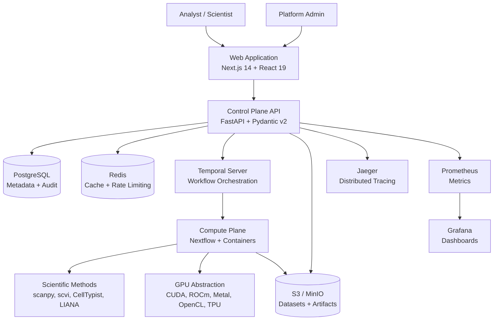
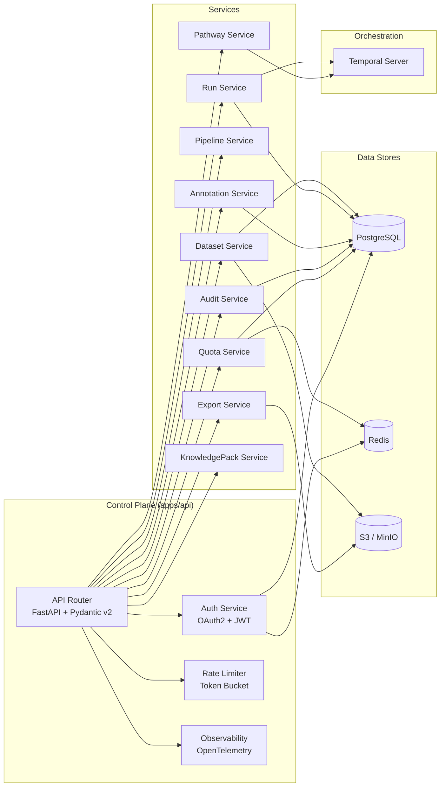
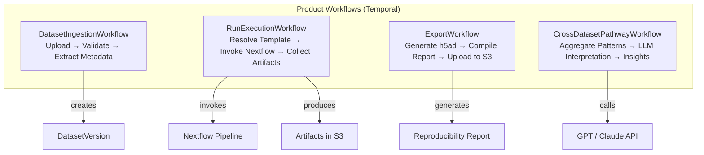
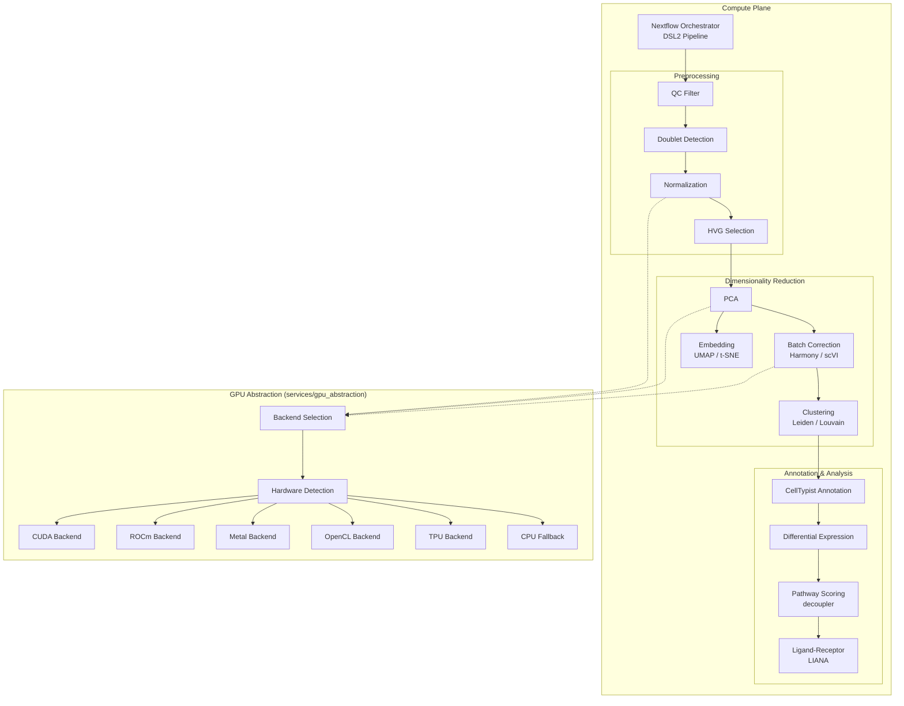
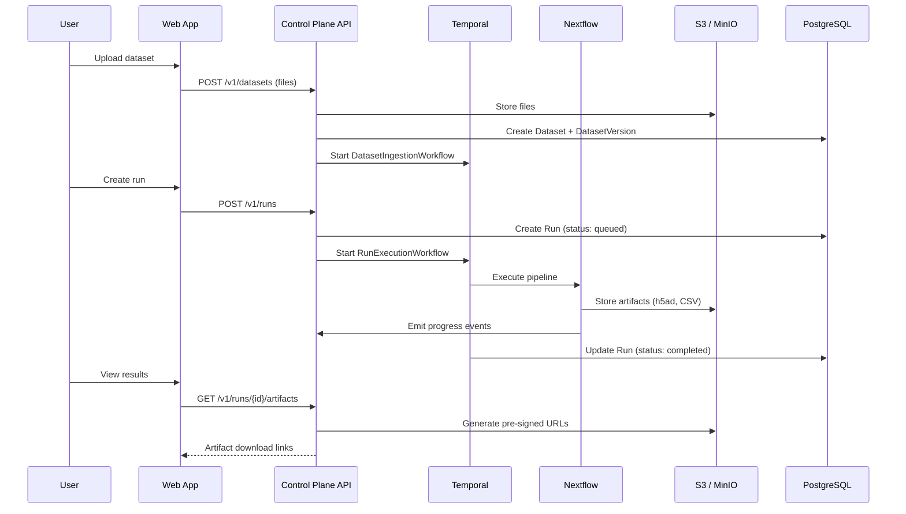
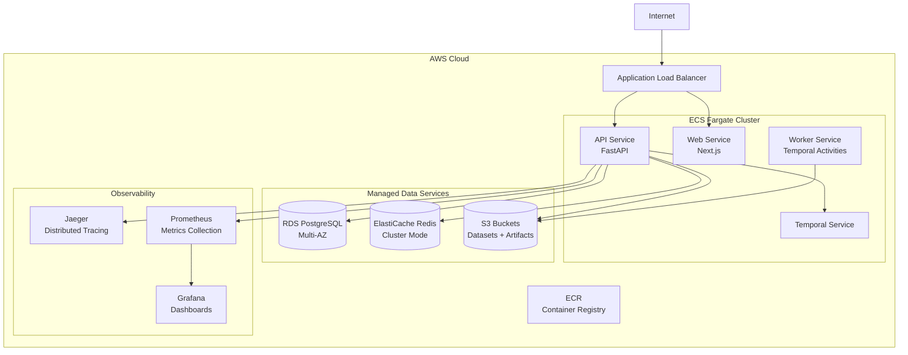

# Zerna Architecture

> Note: parts of this document still describe the broader cloud/ECS target architecture. The currently validated lightweight deployment path in this repo is the Temporal worker runtime plus the EC2 Compose surface documented in [`README.md`](../README.md) and [`DOCKER_SETUP.md`](../DOCKER_SETUP.md).

## Overview

Zerna is a cloud-native single-cell analysis platform with a clean separation between the **Control Plane** (product workflows, metadata, API) and the **Compute Plane** (scientific pipeline execution). A **Frontend** application provides interactive data exploration.

## System Context



---

## Control Plane

The Control Plane is a FastAPI application (`apps/api`) backed by PostgreSQL, Redis, and Temporal. It handles authentication, metadata management, API routing, and product workflow orchestration.

### Control Plane Architecture



### Key Components

| Component          | Location                               | Responsibility                                                   |
| ------------------ | -------------------------------------- | ---------------------------------------------------------------- |
| API Router         | `apps/api/routes/`                     | RESTful endpoints with Pydantic v2 validation                    |
| Auth Service       | `apps/api/services/auth_service.py`    | OAuth2 + JWT authentication, RBAC                                |
| Rate Limiter       | `apps/api/middleware/rate_limiting.py` | Token bucket per user (100 req/min, admin exempt)                |
| Observability      | `apps/api/middleware/tracing.py`       | OpenTelemetry spans, request_id injection                        |
| Temporal Workflows | `workflows/`                           | Dataset ingestion, run execution, export, cross-dataset analysis |

### API Route Groups

| Prefix                | Tag             | Description                                |
| --------------------- | --------------- | ------------------------------------------ |
| `/v1/auth`            | authentication  | Login, token refresh                       |
| `/v1/datasets`        | datasets        | CRUD, versioning, file upload              |
| `/v1/runs`            | runs            | Create, list, cancel, artifacts            |
| `/v1/pipelines`       | pipelines       | Template CRUD, parameter validation        |
| `/v1/annotations`     | annotations     | Revision CRUD, approval workflow           |
| `/v1/knowledge-packs` | knowledge-packs | Reference data management                  |
| `/v1/pathway`         | pathway         | Cross-dataset analysis, LLM interpretation |
| `/v1/exports`         | exports         | h5ad, CSV, reproducibility reports         |
| `/v1/quotas`          | quotas          | Storage and compute monitoring             |
| `/v1/audit`           | audit           | Immutable event log                        |

### Temporal Workflows



---

## Compute Plane

The Compute Plane executes scientific pipelines using Nextflow DSL2 with containerized method definitions. Each method is an isolated Python module with explicit Pydantic input/output schemas.

### Compute Plane Architecture



### Pipeline Execution Flow

The Nextflow pipeline (`services/compute/nextflow/main.nf`) executes methods in dependency order:

1. **QC Filter** → Remove low-quality cells (gene count, mito %)
2. **Doublet Detection** → Identify and flag doublets (scrublet)
3. **Normalization** → Library-size normalization + log1p + scaling
4. **HVG Selection** → Select highly variable genes (seurat_v3)
5. **PCA** → Dimensionality reduction to N components
6. **Batch Correction** _(optional)_ → Harmony or scVI
7. **Clustering** → Leiden or Louvain community detection
8. **Embedding** → UMAP or t-SNE 2D/3D projection
9. **Cell Type Annotation** → CellTypist with majority voting
10. **Differential Expression** → Wilcoxon/t-test between clusters
11. **Pathway Scoring** _(optional)_ → decoupler activity inference
12. **Ligand-Receptor** _(optional)_ → LIANA cell-cell communication

Each step emits a progress event to the Control Plane for real-time UI updates.

### Method Definition Contract

All methods extend `MethodDefinition` (`methods/base.py`):

```python
class MethodDefinition(ABC):
    name: str
    version: str
    compute_preference: ComputePreference  # CPU_ONLY, GPU_PREFERRED, GPU_REQUIRED

    def input_schema(self) -> Type[BaseModel]: ...
    def output_schema(self) -> Type[BaseModel]: ...
    def execute(self, input: BaseModel, compute: ComputeContext) -> BaseModel: ...
```

Methods declare a `compute_preference` that the GPU abstraction layer uses to select the optimal backend at runtime. GPU-preferred methods include CPU fallback paths.

---

## Data Flow



---

## Deployment Architecture

Zerna deploys to AWS using ECS Fargate with managed data services.



### Deployment Details

| Service  | Container        | Port | Scaling                        |
| -------- | ---------------- | ---- | ------------------------------ |
| API      | `zerna-api`      | 8000 | Horizontal (ECS desired count) |
| Web      | `zerna-web`      | 3000 | Horizontal (ECS desired count) |
| Temporal | `zerna-temporal` | 7233 | Single instance                |
| Worker   | `zerna-worker`   | —    | Horizontal (task queue based)  |

### CI/CD Pipeline

- **CI**: GitHub Actions runs lint, type-check, and tests on every PR
- **CD**: Pushes to `staging` branch deploy to staging; pushes to `main` deploy to production
- **Authentication**: OIDC-based AWS credentials (no long-lived keys)
- **Rollback**: `./scripts/rollback.sh <environment>` reverts all ECS services to previous task definition revision

### Local Development Stack

For local development, Docker Compose provides all infrastructure services:

| Service    | Image                           | Port                                                                 |
| ---------- | ------------------------------- | -------------------------------------------------------------------- |
| PostgreSQL | `postgres:16-alpine`            | 5432                                                                 |
| Redis      | `redis:7-alpine`                | 6379                                                                 |
| Temporal   | `temporalio/auto-setup:1.22.4`  | 7233, 8080                                                           |
| Jaeger     | `jaegertracing/all-in-one:1.52` | 16686, 4317                                                          |
| MinIO      | `minio/minio:latest`            | 9000/9001 in container; host defaults `19000`/`19001` (`MINIO_PORT`) |
| Prometheus | `prom/prometheus:v2.48.0`       | 9090                                                                 |
| Grafana    | `grafana/grafana:10.2.0`        | 3001                                                                 |
